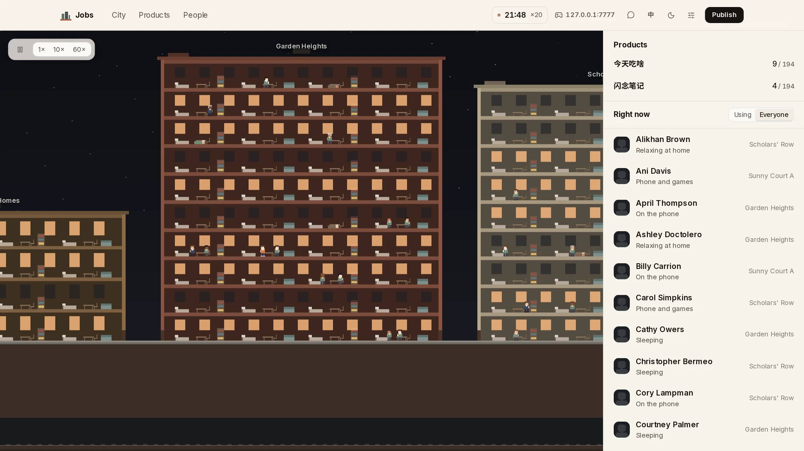

<div align="center">

<picture>
  <source media="(prefers-color-scheme: dark)" srcset="docs/images/banner.en.dark.svg">
  
</picture>

<br>

**Launch your product into a town of 200 AI residents and see who notices it,<br>who tries it, and who stays, before real users do.**

[](https://github.com/PlutoKeating/Project.Jobs/releases)
[](LICENSE)
[](docs/INSTALL.md)
[](#use-it-from-anywhere)

[Website](https://jobs.plutokeating.beer/en) · [Install](#install) · [How it works](#how-it-works) · [Use it from anywhere](#use-it-from-anywhere) · [Docs](#documentation) · [简体中文](README.zh-CN.md)

</div>

<picture>
  <source media="(prefers-color-scheme: dark)" srcset="site/shots/city-en-dark.webp">
  
</picture>

<p align="center"><sub>The town is called Jobs Town, in tribute to the great product maker Steve Jobs: start from the people who will use it.</sub></p>

Hand Jobs a URL. Two hundred very different people live in **JobsWorld**. They get on with their own days, come across your product in the app store, in ads and from friends, and decide for themselves whether to look, to use it, to stay and whom to tell. You read one plain page, and every sentence on it opens to who said it, their words and the screen at that moment.

## Install

```bash
curl -fsSL https://jobs.plutokeating.beer/install | bash
```

You need a machine with Docker, x86_64 or arm64. The script prints an address and two passcodes; then:

1. Open the address and sign in with the admin passcode.
2. In **Settings › Models**, pick a provider, paste a key, tick the models, save.
3. Back in the town, press **Publish** and paste a URL, a name and one line. A dev server on `127.0.0.1` works.

No product at hand? The same dialog offers sample products with real little flaws.

> [!NOTE]
> Verified on a clean Linux Docker host. The macOS and Windows (WSL2) paths have unit tests only and have not been installed on real machines. Upgrading is one click in the web page, `jobsworld update`, or the same line again; the database is backed up first. Details: [`docs/INSTALL.md`](docs/INSTALL.md).

## How it works

<picture>
  <source media="(prefers-color-scheme: dark)" srcset="docs/images/journey.en.dark.svg">
  
</picture>

Nobody is assigned to test. Rules work out who comes across your product and who notices it, with no model call. Only someone who noticed gets to say, in one model call, whether they open it.

### The screen is all they can see

<picture>
  <source media="(prefers-color-scheme: dark)" srcset="docs/images/screen.en.dark.svg">
  
</picture>

Each resident uses it in their own here and now: on the subway with one free hand, minding a child, with five minutes left. When a product asks them to sign up, they use the mailbox the town issued them: paste a Cloudflare token in Settings and real verification mail reaches them, and they switch to their mail app to read the code like anyone would.

### One plain page

<picture>
  <source media="(prefers-color-scheme: dark)" srcset="docs/images/verdict.en.dark.svg">
  
</picture>

Whether it works, what hurt most, who stays and who leaves, why people who saw it did not open it, and the one thing to fix first. Technical signals a user never sees (accessibility scans, API and script errors) stay out of the conclusion and go into a separate engineering appendix.

## Use it from anywhere

| Way in | What you do there |
|---|---|
| **Web** | The town comes first. Launch, watch who is using what, read the conclusion, tune promotion, hand the phone to a few people. "Ask Jobs" at the bottom right of every page talks to the same agent as Feishu. |
| **Command line** | `jobsworld publish`, `status`, `invite`, `report`, `promote`, `reset`, `remove`, `issues`, `fix`, `town`, `find`, and `jobsworld chat` to just talk. |
| **Coding agent** | An MCP server: launch as soon as the code is written, pull back issues with steps to reproduce, keep fixing. Issues can also become GitHub issues; closing one marks a new version and invites the same kind of people to check the fix. |
| **Feishu** | Scan a QR code in the web page, then just talk, from your phone at lunch or on the way home: launch, invite, read the verdict with screenshots, talk to a resident, export the verdict as a cloud doc, hand a fix to a coding agent. Replies stream into a card with each step it takes; resets ask for a tap to confirm. It speaks up for serious first issues, changed verdicts and anything that needs you, sends a morning and evening digest, and keeps a live board per product. |
| **Terraria** | Walk into the same town with a vanilla or tModLoader client. `/jw launches`, `/jw publish`, `/jw invite`. |

```bash
jobsworld publish http://127.0.0.1:3000/ \
  --name "Quick Notes" --tagline "Write it down the moment you think of it"
jobsworld status "Quick Notes"          # who saw it, noticed, opened, came back
jobsworld invite "Quick Notes" -n 3     # don't wait: hand the phone to three people
jobsworld report "Quick Notes" --eng    # conclusion, issues to reproduce, appendix
```

<picture>
  <source media="(prefers-color-scheme: dark)" srcset="docs/images/loop.en.dark.svg">
  
</picture>

```bash
# One link is all an agent needs; it opens a browser page where you enter the passcode
claude mcp add --transport http jobs https://<your Jobs address>/mcp
codex mcp add jobs --url https://<your Jobs address>/mcp
```

MCP tools: `publish_product`, `list_products`, `product_status`, `product_report`, `invite_people`, `cancel_invites`, `wait_for_people`, `mark_new_version`, `set_promotion`, `reset_product`, `remove_product`, `ask_person`. The admin passcode allows every tool; the viewer passcode only the read-only ones. The web page has the link and the command for each agent (the robot icon, top right). Jobs on another machine or in the cloud needs `JOBS_PUBLIC_URL` set to its https address behind a reverse proxy ([`docs/INSTALL.md`](docs/INSTALL.md)), and the product you publish has to be reachable from there: JobsWorld is for real products, not a demo on your laptop. On the same machine, `jobsworld mcp` (stdio) still works.

> [!TIP]
> The installed command is `jobsworld`. A `jobs` alias exists for configs that execute it directly, but in a terminal `jobs` is a bash, zsh and fish builtin. Inside this repository, use `pnpm jobs`.

## How it is built

<picture>
  <source media="(prefers-color-scheme: dark)" srcset="docs/images/stack.en.dark.svg">
  
</picture>

Everything runs on your machine. Residents, memories, screenshots and conclusions live in Docker volumes there. You bring the models, and what you have spent stays in the page header; there is no spending cap.

<details>
<summary><b>Repository layout</b></summary>

| Path | What it is |
|---|---|
| `apps/cli` | The command line (`jobsworld` once installed, `pnpm jobs` in this repo) and the MCP server; `dev …` holds the internal calibration batches |
| `apps/api` | REST `/api/v1`, live updates over WebSocket, the hosted web page, the Feishu channel and pushes |
| `apps/web` | The web page (React): the side-view pixel town, product pages, people, session replay |
| `apps/world` | The world service: clock, schedules, needs, places; drives the launch engine; broadcasts over NATS |
| `apps/gateway` | Single-port gateway: HTTP to the API, vanilla Terraria to TShock, tModLoader to tML |
| `packages/jobsworld` | The town's contract and rules: layout, schedules, needs, residents and ties, here-and-now context, NATS subjects |
| `packages/engine` | The launch pipeline (`launch/`), people (memory, perception, population), one usage session, evaluation and issue synthesis |
| `packages/executor` | Browser sandbox (desktop and mobile web), locating by screenshot with Midscene, the human hand, policy gate, recording |
| `packages/memory` | One [ewave](https://www.npmjs.com/package/@plutokeating/ewave) memory tree per resident |
| `packages/agent` | The Jobs Agent behind Feishu, "Ask Jobs" and `jobsworld chat`: [Pi](https://github.com/earendil-works/pi)'s agent loop over our own model router, the same tools as MCP |
| `packages/llm` | In-app model router: providers, credentials, failover, tool calling for the agent, an OpenAI-compatible endpoint, spend records |
| `packages/core` · `packages/db` · `packages/storage` | Types and schemas · Drizzle tables and migrations · evidence storage (MinIO/S3, content-addressed) |
| `game/` · `infra/game/` | Terraria plugin and mod (C#) · game server images |
| `demos/kit` | 11 sample products, each in a clean version and one with known flaws |
| `Dockerfile` · `deploy/` · `.github/workflows/` | The main image · entrypoint, compose files, the install script, the `jobsworld` launcher · the release workflow |
| `site/` | The website `jobs.plutokeating.beer`, a copy of the install script, and the source of the diagrams on this page ([`site/docs/README.md`](site/docs/README.md)) |
| `docker-compose.yml` · `infra/` | Dependencies and local game server builds when running from source |
| `config/` · `scripts/` · `tests/` | Population tables, bundled residents and their going-out vocabulary, town layout, model catalog · start-up and sync scripts · unit and integration tests |
| `docs/` | Documentation and the images on this page (`docs/images/`); `docs/research/` holds field research and how it shapes the residents; `docs/history/` holds design drafts from before the reshape |

</details>

## Run from source

Node 22 or newer, pnpm, Docker and ffmpeg.

```bash
cp .env.example .env && pnpm install && npx playwright install chromium
docker compose up -d      # Postgres + pgvector, MinIO, NATS
pnpm jobs init            # migrate, move the bundled residents in, register the sample products
pnpm jobsworld            # world service + API and web + gateway at http://127.0.0.1:7777/
```

The rest is in [`docs/QUICK_START.md`](docs/QUICK_START.md).

## What it is, and what it is not

> [!IMPORTANT]
> Every head count is what actually happened in this simulated town. It is not a forecast of a real market, and nothing here has been calibrated against real users yet. Feedback from synthetic users runs shallow and positive, and misses the long tail. Jobs does not replace research with real people: it shows you, before you have a single user, what happens when a crowd of very different people meets your product for the first time.

- **Where the residents come from.** Chinese residents are drawn from census-style sampling tables with hand-set values; English-speaking residents are sampled from [NVIDIA Nemotron-Personas-USA](https://huggingface.co/datasets/nvidia/Nemotron-Personas-USA) (CC BY 4.0). Rules derive every number (literacy, eyesight, patience, price sensitivity); the model only writes names, life stories and opinions. A fresh install has 199 residents.
- **What has been verified, and what has not.** Model calls have only run for real against Gemini on Vertex. The rebuilt Feishu channel has been tested against a simulated Feishu API and the QR code comes back from Feishu, but has not yet been used with a real account; the same agent has run for real in the web page and the terminal. The full record is in [`docs/VERIFICATION.md`](docs/VERIFICATION.md).

## Documentation

The documentation is written in Chinese.

| | |
|---|---|
| [`docs/INSTALL.md`](docs/INSTALL.md) | Installing, upgrading, backups, Feishu, Terraria, building it yourself |
| [`docs/QUICK_START.md`](docs/QUICK_START.md) | Running from source, common commands, troubleshooting |
| [`docs/MODELS.md`](docs/MODELS.md) | Connecting model providers and how routing works |
| [`docs/ARCHITECTURE.md`](docs/ARCHITECTURE.md) · [`docs/API.md`](docs/API.md) | How it is put together · REST, WebSocket, MCP |
| [`docs/JOBSWORLD.md`](docs/JOBSWORLD.md) | The town and the game |
| [`docs/DECISIONS_2026-11-15.md`](docs/DECISIONS_2026-11-15.md) | Product decisions; this wins where documents disagree |
| [`docs/VERIFICATION.md`](docs/VERIFICATION.md) · [`docs/CALIBRATION.md`](docs/CALIBRATION.md) | What has been verified and known limits · internal calibration |

<br>

<p align="center"><sub>© 2026 PlutoKeating · <a href="LICENSE">AGPL-3.0-only</a> · Bundled third-party work keeps its own licence: the Inter font (<a href="apps/web/public/fonts/LICENSE-Inter.txt">OFL 1.1</a>) and a schematic reader ported from TEdit (<a href="game/shared/Schematics/TEdit-LICENSE.txt">Ms-PL</a>).</sub></p>
