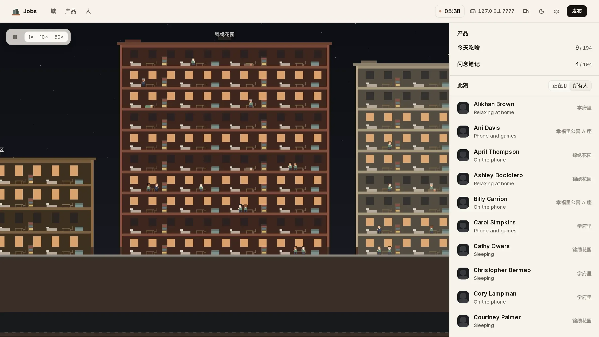

<div align="center">

<picture>
  <source media="(prefers-color-scheme: dark)" srcset="docs/images/banner.zh.dark.svg">
  
</picture>

<br>

**把产品发布到一座住着两百位虚拟居民的城里：<br>在真实用户到来之前，先看谁会注意到它、谁会用、谁会留下。**

[](https://github.com/PlutoKeating/Project.Jobs/releases)
[](LICENSE)
[](docs/INSTALL.md)
[](#入口)

[官网](https://jobs.plutokeating.beer) · [安装](#安装) · [它怎么工作](#它怎么工作) · [入口](#入口) · [文档](#文档) · [English](README.md)

</div>

<picture>
  <source media="(prefers-color-scheme: dark)" srcset="site/shots/city-zh-dark.webp">
  
</picture>

<p align="center"><sub>这座城叫乔布斯镇，以此致敬伟大的产品人 Steve Jobs：做产品，先从用它的人出发。</sub></p>

把网址交给 Jobs。**JobsWorld** 里住着两百个各不相同的人：他们过着自己的日子，在应用商店、广告和朋友口中遇到你的产品，自己决定看不看、用不用、留不留、跟谁说。你读到的是一页人话，每一句都能点开看是谁说的、原话是什么、当时屏幕上是什么。

## 安装

```bash
curl -fsSL https://jobs.plutokeating.beer/install | bash
```

需要一台装了 Docker 的机器，x86_64 或 arm64 都行。装完会打印访问地址和两个口令，然后：

1. 打开那个地址，用管理员口令进去。
2. 在「模型」页选一家供应商，粘贴 Key，勾选模型，保存。
3. 回到城里点「发布」：粘贴网址、名字、一句话。`127.0.0.1` 上的开发服务器也行。

手头没有产品？发布对话框里有带着真实小毛病的示例产品可选。

> [!NOTE]
> 在一台全新的 Linux Docker 环境里装成功过。macOS 与 Windows（WSL2）的安装路径只有单元测试，没有在真机上装过。升级有三种方式：网页上一键升级、`jobsworld update`、重新运行上面这一行；都会先备份数据库。详见 [`docs/INSTALL.md`](docs/INSTALL.md)。

## 它怎么工作

<picture>
  <source media="(prefers-color-scheme: dark)" srcset="docs/images/journey.zh.dark.svg">
  
</picture>

没有人被指派去测试。谁会遇到你的产品、谁会注意到，由规则计算，不调用模型；只有注意到的人，才由他自己说要不要点开（一次模型调用）。

### 他们只看得到屏幕

<picture>
  <source media="(prefers-color-scheme: dark)" srcset="docs/images/screen.zh.dark.svg">
  
</picture>

每个人都在自己此时此地的处境里用：地铁上单手拿着手机、带着孩子、只剩五分钟。产品要注册时，他们用城里发的邮箱：在「设置」里贴一枚 Cloudflare 令牌，真实的验证邮件就能送到，他们会像普通人一样切到邮箱看验证码。

### 读一页人话

<picture>
  <source media="(prefers-color-scheme: dark)" srcset="docs/images/verdict.zh.dark.svg">
  
</picture>

好不好用，哪里最让人难受，谁会留下谁会走，看到的人为什么没点开，最该改的一件事。用户看不到的技术信号（无障碍扫描、接口与脚本错误）不进结论，单独放进工程附录。

## 入口

| 入口 | 在这里做什么 |
|---|---|
| **网页** | 第一眼是城。发布、看谁正在用、读结论、调宣发、把手机递给几个人。 |
| **命令行** | `jobsworld publish`、`status`、`invite`、`report`、`promote`。 |
| **Coding agent** | 一个 MCP 服务：写完代码就发布，取回带复现步骤的问题清单，接着改。 |
| **飞书** | 在网页上扫码接入后，在飞书里发布、看状况、向居民追问；有进展时机器人会主动告诉你。 |
| **Terraria** | 用原版或 tModLoader 客户端走进同一座城。`/jw launches`、`/jw publish`、`/jw invite`。 |

```bash
jobsworld publish http://127.0.0.1:3000/ --name 闪念笔记 --tagline "想到什么，马上记下"
jobsworld status 闪念笔记            # 多少人看到、注意到、打开过、回来再用；路过的人怎么想
jobsworld invite 闪念笔记 -n 3       # 不等他们自己遇到：把手机递给三个人
jobsworld report 闪念笔记 --eng      # 一页结论 + 带复现步骤的问题 + 工程附录
```

<picture>
  <source media="(prefers-color-scheme: dark)" srcset="docs/images/loop.zh.dark.svg">
  
</picture>

```bash
# agent 只要一个链接；第一次连接时会打开浏览器，输入口令授权
claude mcp add --transport http jobs https://<你的 Jobs 地址>/mcp
codex mcp add jobs --url https://<你的 Jobs 地址>/mcp
```

MCP 工具：`publish_product`、`list_products`、`product_status`、`product_report`、`invite_people`、`wait_for_people`、`mark_new_version`、`set_promotion`、`ask_person`。用管理员口令授权能用全部工具，用访客口令只能用只读的那几个。网页右上角的机器人图标里有链接和各家 agent 的接入命令。Jobs 装在别的机器或云端时，要在反向代理后面设置 `JOBS_PUBLIC_URL`（https，见 [`docs/INSTALL.md`](docs/INSTALL.md)）；发布的产品也必须是那台机器能打开的地址。JobsWorld 是用来体验真实产品的，不是给你电脑上的工程 demo 用的。和 Jobs 在同一台机器上时，`jobsworld mcp`（stdio）照样能用。

> [!TIP]
> 装好之后的命令叫 `jobsworld`。`jobs` 这个名字留作别名，给直接执行它的配置用；但在终端里 `jobs` 是 bash、zsh、fish 的内建命令，直接敲会被 shell 截走。在仓库里开发时用 `pnpm jobs`。

## 它怎么搭起来的

<picture>
  <source media="(prefers-color-scheme: dark)" srcset="docs/images/stack.zh.dark.svg">
  
</picture>

全部跑在你自己的机器上：居民、记忆、截图和结论都存在那里的 Docker 卷里。模型由你接入，花了多少页头一直显示；不设花费上限。

<details>
<summary><b>仓库结构</b></summary>

| 路径 | 说明 |
|---|---|
| `apps/cli` | 命令行（装好后是 `jobsworld`，仓库里是 `pnpm jobs`）：发布、状况、结论、宣发、递手机、MCP 服务；`dev …` 子命令收纳内部校准用的指派式批次 |
| `apps/api` | REST `/api/v1`（发布、模型接入、人物、世界、使用过程、证据、虚拟身份收件箱、游戏服开关）+ WebSocket 实时推送 + 托管网页 + 飞书机器人 |
| `apps/web` | 网页（React）：侧视像素城、产品页（结论 / 人 / 口碑 / 工程附录）、人物、使用过程回看 |
| `apps/world` | 世界服务：时钟、日程、需求、位置；驱动发布引擎（曝光 → 决定 → 使用 → 口碑）；NATS 广播 |
| `apps/gateway` | 单端口网关：HTTP → API，原版 Terraria → TShock，tModLoader → tML |
| `packages/jobsworld` | 城的契约与规则：城镇布局、日程、需求、居民与关系网、此时此地的处境、NATS 主题与消息 |
| `packages/engine` | 发布主线（`launch/`）、人（记忆、感知、人口）、一次使用的运行、事后评估与问题合成；内部校准批次 |
| `packages/executor` | 浏览器沙箱（电脑 / 手机网页触屏）、Midscene 看截图定位、人类化的手、Policy Gate、模态注入、录像 |
| `packages/memory` | 人物记忆：每人一棵 ewave 记忆树（`@plutokeating/ewave`）的适配层 |
| `packages/llm` | 应用内模型路由：多供应商、多凭证、多模型的运行时配置（目录、加密凭证、版本、全局顺序）、失败接替、OpenAI 兼容入口、花费记录 |
| `packages/core` · `packages/db` · `packages/storage` | 类型与 schema · Drizzle 表与迁移 · 证据存储（MinIO/S3，内容寻址） |
| `game/` · `infra/game/` | Terraria 两个游戏端的插件与模组（C#）· 游戏服镜像 |
| `demos/kit` | 11 个示例产品（每个有干净版与带着已知毛病的版本），用于演示与校准 |
| `Dockerfile` · `deploy/` · `site/` · `.github/workflows/` | 主镜像；容器入口、装好后用的编排文件、安装脚本、`jobsworld` 命令；官网 `jobs.plutokeating.beer`（落地页、关于、条款、隐私，中英双语、明暗两种外观；页面由 `site/scripts/build.mjs` 从 `site/src/` 生成后提交）、安装脚本副本与 Cloudflare 部署配置，也是本页示意图的源（`site/src/figures.mjs`，见 [`site/docs/README.md`](site/docs/README.md)）；打标签时构建并推送镜像的工作流 |
| `docker-compose.yml` · `infra/` | 从源码运行时的依赖服务与游戏服的本地构建；游戏服镜像的构建文件、数据库初始化脚本 |
| `config/` | 人口抽样表与随包居民（`population/`）、城镇布局与日程骨架（`jobsworld/`）、手写人物（`personas/`）、模型目录快照（`models/`）、全局参数（`pux.config.yaml`）、校准批次用的手写场景（`worlds/`）与儿童安全规则（`rubrics/`） |
| `scripts/` · `tests/` · `examples/calibration/` | 启动脚本、游戏协议探针、目录与安装脚本的同步工具 · 单元与集成测试 · 校准输入的示例文件 |
| `docs/` | 文档；`docs/images/` 是本页的示意图（生成物）；`docs/history/` 是重塑之前的设计稿与校准记录，不描述当前系统 |

</details>

## 从源码运行

需要 Node 22 以上、pnpm、Docker 和 ffmpeg。

```bash
cp .env.example .env && pnpm install && npx playwright install chromium
docker compose up -d      # Postgres + pgvector、MinIO、NATS
pnpm jobs init            # 迁移数据库，让随包居民入住，注册示例产品
pnpm jobsworld            # 世界服务 + 接口与网页 + 网关：http://127.0.0.1:7777/
```

其余见 [`docs/QUICK_START.md`](docs/QUICK_START.md)。

## 它是什么，不是什么

> [!IMPORTANT]
> 所有人数都是这座城里实际发生的人数，是**模拟**，不是对真实市场的预测；尚未用真人数据校准。合成用户的反馈偏浅、偏正面、缺少长尾。Jobs **不取代真人用户研究**：它让你在没有任何真实用户之前，先看到一群各不相同的人第一次遇到你的产品时会发生什么。

- **人口从哪来。** 中国人群按普查口径的条件抽样表生成（数值是手工设定的近似值，不是微观数据拟合）；英语区人群从 [NVIDIA Nemotron-Personas-USA](https://huggingface.co/datasets/nvidia/Nemotron-Personas-USA)（CC BY 4.0）抽样。识字量、视力、耐心、价格敏感度等数值全部由规则推导；模型只写名字、生平和看法。新装好的城里一共 199 人（随包 185 位居民加 14 位手写人物），重新生成：`pnpm jobs world populate -n <人数>`。
- **验证过什么，没验证什么。** 模型的真实调用只在 Vertex 上的 Gemini 验证过；飞书扫码之后的环节没有用真实账号验证过。完整记录见 [`docs/VERIFICATION.md`](docs/VERIFICATION.md)。

## 文档

| | |
|---|---|
| [`docs/INSTALL.md`](docs/INSTALL.md) | 安装、升级、备份、飞书、Terraria、自己构建 |
| [`docs/QUICK_START.md`](docs/QUICK_START.md) | 从源码运行、常用命令、故障排查 |
| [`docs/MODELS.md`](docs/MODELS.md) | 接入模型供应商，路由怎么工作 |
| [`docs/ARCHITECTURE.md`](docs/ARCHITECTURE.md) · [`docs/API.md`](docs/API.md) | 架构 · REST、WebSocket、MCP |
| [`docs/JOBSWORLD.md`](docs/JOBSWORLD.md) | 城与游戏 |
| [`docs/DECISIONS_2026-11-15.md`](docs/DECISIONS_2026-11-15.md) | 产品决策（文档之间有冲突时以它为准） |
| [`docs/VERIFICATION.md`](docs/VERIFICATION.md) · [`docs/CALIBRATION.md`](docs/CALIBRATION.md) | 验证记录与已知局限 · 校准（内部） |

<br>

<p align="center"><sub>© 2026 PlutoKeating · <a href="LICENSE">AGPL-3.0-only</a> · 仓库里有两处第三方内容保留各自的许可证：Inter 字体（<a href="apps/web/public/fonts/LICENSE-Inter.txt">OFL 1.1</a>），以及移植自 TEdit 的蓝图读取（<a href="game/shared/Schematics/TEdit-LICENSE.txt">Ms-PL</a>）。</sub></p>
