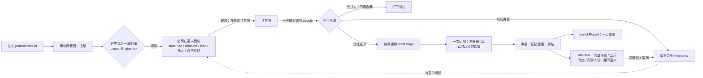
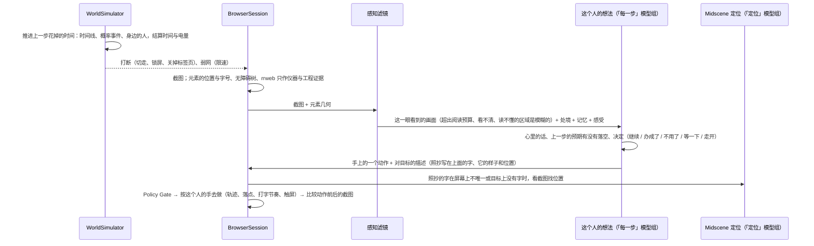

# 架构

> 本文描述当前代码的实际实现。产品决策见 [`DECISIONS_2026-11-15.md`](DECISIONS_2026-11-15.md)；城见 [`JOBSWORLD.md`](JOBSWORLD.md)；模型接入见 [`MODELS.md`](MODELS.md)；安装形态见 [`INSTALL.md`](INSTALL.md)。

## 1. 部署形态

```
宿主机（pnpm / Node 24 原生运行）                     docker compose（只跑依赖）
┌──────────────────────────────────────────┐        ┌──────────────────────────────┐
│ apps/cli      命令行 + 本机 MCP（stdio）     │        │ postgres  pgvector/pg17      │ 55432
│ apps/api      接口 + 网页 + 飞书 + 远程 MCP │
│ packages/agent Jobs Agent（飞书/网页/终端）  │──────▶ │ minio     S3 兼容证据存储     │ 59000/59001
│ apps/world    世界服务 + 发布引擎           │        │ nats      事件总线            │ 54222/58222
│ apps/gateway  单端口网关 0.0.0.0:7777       │        │ tshock/tml 游戏服（profile game）│ 57777/57778
│ demos/kit     11 个示例产品（22 个实例）     │        └──────────────────────────────┘
│ packages/llm  应用内模型路由 ───────────────┼──▶ 各家模型供应商（管理员在网页里接入）
└──────────────────────────────────────────┘
```

- **唯一权威数据源**：Postgres（结构化数据）+ MinIO（截图、录像等大文件，按内容哈希寻址、只追加）。
- **谁在驱动**：世界服务。它推进时钟、日程与需求，并每 10 秒让发布引擎算一遍「这段时间里谁遇到了什么」；使用过程（浏览器会话）在世界服务进程内并发运行（`JW_CONCURRENCY`，默认 3；`JW_RUNNER=0` 关闭）。API 只读写数据库并经 NATS 向世界服务发命令。
- **居民邮箱**：真实产品发的验证邮件经 Cloudflare 进来。邮件域名就是公网链接的主机名，它的 MX 由 Cloudflare Email Routing 接收；每个居民一条收信规则（开通后在后台预先建到上限，其余的人开始用产品时再建），交给 Cloudflare 上的转发 Worker；Worker 只把原始邮件加签名后 POST 回 `<公网链接>/inbound/email`。收信、解析、存储、界面都在 Jobs 里（`packages/engine/src/mail/`，见 §6）。维护者只在网页「设置」里填公网链接、贴一枚 Cloudflare API Token。
- **模型**：应用内路由（`packages/llm`）。代码里的调用点只说自己是哪个角色，角色归到五个模型组（每一步、归纳、定位、向量、画图）；用哪家的哪个模型、按什么顺序接替，由管理员在网页的「设置 › 模型」里配置并保存，几秒内生效。见 [`MODELS.md`](MODELS.md)。

上图是从源码运行时的形态。**装好的 Jobs**（[`INSTALL.md`](INSTALL.md)）把左边一列全部打进一个镜像，由 `deploy/entrypoint.sh` 先迁移数据库、让随包居民入住，再启动世界服务、接口、网关和示例产品；右边仍是各自的标准镜像（`deploy/compose.yml`）。Linux 上 `jobs` 容器用宿主机网络（本机回环地址上的开发服务器原样可达），其他系统用端口映射并把本机地址换成 `host.docker.internal`（`reachableUrl`）。网页上的「一键开启游戏服」与「一键升级」不让容器接触 Docker：容器只写一个请求文件，由宿主机上的 `jobsworld _control`（systemd 监视单元触发）执行；升级的进度与结果再写回同一个目录（`control/`）。版本号只有根 `package.json` 一个来源（`@pux/core` 的 `jobsVersion()`）；接口每小时读一次 GitHub 上最新的 Release（管理员打开网页时结果超过 15 分钟就当场重查），网页据此提示管理员升级（`apps/api/src/update.ts`）。升级流程（`deploy/jobs` 的 `update`，安装脚本重复运行时同理）：拉取镜像 → 取出新的编排文件与命令 → 备份数据库到 `~/.jobs/backups` → 重建容器（入口脚本迁移数据库）→ 更新装过的游戏服。

## 2. 发布主线（`packages/engine/src/launch/`）



| 模块 | 做什么 |
|---|---|
| `launch.ts` | `publishProduct`（建产品、拍商店页截图、建内部容器）、`setPromotion`、`launchFunnel`（按人去重的五层人数）、`storeListing` |
| `exposure.ts` | `audienceMatch`（投给谁）、`exposureChance`（每个渠道在这段时间里遇到的概率：宣发强度 × 手机在不在手边 × 是否投放对象 × 看腻了没有）、`notices`（注意到的概率）、`whatTheySee`（他在那个渠道里实际看到的样子）、`normFor`（每个渠道的常态）、`decide`（注意到之后由他自己说） |
| `engine.ts` | `LaunchEngine.tick`：先处理之前留下的念头（熟人提过、想以后看看、用过想再用），再算新的曝光；决定与使用都有并发上限；每累计几次使用后重新合成问题 |
| `usage.ts` | `startUsage`（把这个人此时此地的处境定下来，建一次使用）、`inviteToLaunch`（把手机递给人，标记为受邀）、`afterUse`（把用完后的打算落成评论、动态、口碑和回访念头） |
| `identity.ts` | 城里发的邮箱、手机号、惯用的用户名（就是邮箱 @ 前面那一段）与密码、钱包；`deliverMail` 把验证邮件与短信送到对应的人（Message-ID 去重，记下到达时他正在进行的那次使用，规则提取验证码与链接作仪器）；`unseenMail` 给使用过程的新信通知（邮件只有发件人和标题）；`payFromWallet` |
| `lifecycle.ts` | 产品的清零与下线（按产品算：同名产品发布过的每一版）。`resetLaunch`：删掉使用过程与它们的证据、问题、评审、曝光、念头、评论、动态、一页结论、版本点、使用期间收到的信，居民记忆树里它的分支与相关记忆（`forgetApp`）、对它的信任与指向它的信念证据；产品本身（地址、介绍、商店截图、宣发设置）不动，状态回到 `live`、发布时刻与花费归零，等于此刻重新发布。`removeLaunch`：从城里拿掉（删掉 `launches` 行、念头、一页结论、版本点，作废没用完的使用）；`keepHistory = false` 时连同上面的全部经历与产品记录一起删掉（内部校准批次还在用这个产品时保留产品记录）。模型调用记录（`llm_traces`）是真实花费，都不删；对 AI 产品整体的信任已经被改动的部分不回退。清库之前，世界服务先让进行中的使用在当前这一步做完后作废（`LaunchEngine.cancel`，作废的使用不整理记忆、不评估、不留口碑） |
| `report.ts` | `gatherMoments`（每个人的关键时刻：第一眼、卡住、离开、办成、用完后说的话、评论与动态；路过没点开的人的想法）→ `launchReport`（用「归纳」模型组写成一页，每条必须引用痕迹；输入有上百条痕迹，单次调用的超时放宽到 8 分钟，素材变了时先给上一版、后台重写）；`experiencedIssues`、`engineeringAppendix` |

规则决定「遇没遇到、注没注意」，模型只在决定点出场：要不要点开、使用时的每一步、用完之后怎么说。数据：`launches`、`exposures`、`intentions`、`store_reviews`、`posts`、`mailbox`、`launch_reports`（迁移 `0007`）。每次发布内部对应一个 `studies` 行，作为使用过程、证据与花费的容器（`trigger = 'launch'`）。

规则参数：每小时遇到的次数上限（广告 2.2、广告牌 0.9、动态 0.5、逛商店 0.14、自己想起 0.2，都还要乘上宣发强度、手机在不在手边等系数）和注意到的概率（广告 0.22、广告牌 0.1、商店 0.6、动态 0.45、熟人当面说 0.95）写在 `exposure.ts` 的 `RATE_PER_HOUR` 与 `NOTICE` 里。它们是手工设定的量级，没有用真实数据校准过。

## 3. 代码结构

| 部分 | 代码位置 | 说明 |
|---|---|---|
| 发布主线 | `packages/engine/src/launch/`、`apps/world`、`apps/api`、`apps/cli` | 见 §2 |
| 人 | `packages/engine/src/human/` | 人物的六层描述（YAML + zod 校验 + 版本哈希）与可选的第七层「出门与吃喝玩乐」（`leisure.ts`：以小时计的本地活动与以天计的出远门、同行时拿不拿主意、定方案时怎么说话、节奏、社交电量、预算与分账、出行方式、吃饭的讲究与雷点、吃过亏后的做法、往事；随包居民按规则推导，依据 `docs/research/`）、手的能力（`motorProfile`）、身心状态的规则（`updateState`）、感知滤镜、识字量、记忆（每人一棵 ewave 记忆树，`packages/memory`：身份与人设自带的往事钉住、对某个产品的态度有界可变、对一类事物的看法要多次独立经历才动）、人口合成 |
| 世界 | `packages/jobsworld/`、`packages/engine/src/world/` | 城镇、日程、需求、居民与关系网、此时此地的处境（`liveContextFor`）；`WorldSimulator` 在一次使用期间运行这份处境生成的世界模板：模拟时钟、时间线、概率事件、资源（时间、电量、钱、注意力、网络）与约束 |
| 一次使用 | `packages/engine/src/runtime/` | 每一步：世界推进 → 打断与弱网 → 截图 → 感知滤镜 → 想法（只看图，说出手上的一个动作）→ 预期有没有落空 → 身心状态更新 → 落点 → Policy Gate → 按这个人的手去做 → 护栏 |
| 居民邮箱 | `packages/engine/src/mail/`、`packages/jobsworld/src/mailhandle.ts`、`apps/api/src/mail.ts`、`apps/web/src/pages/Settings.tsx` | 设置（公网链接、部署状态，存 `world_kv`）、Cloudflare 接口封装、转发 Worker 的源码、一键开通 / 关闭、按需收信规则与回收、收信验签与解析、测试信、网页邮箱（在使用过程的浏览器里拦截 `https://mail.<邮件域名>/` 画出收件箱）、仪器用的验证码与链接提取；像真人的邮箱用户名 |
| 执行层 | `packages/executor/` | UAP 接口（`packages/core/src/types/uap.ts`）的浏览器实现：一个会话一个独立的 Chromium、看截图定位、人类化的手、六层错误分类、Policy Gate、语音与摄像头注入、录像、rrweb、无障碍扫描 |
| 证据 | `packages/executor/src/evidence.ts`；`evidence`、`evidence_links`、`repro_paths` 表 | 所有截图、录像、日志按内容哈希登记，并与步骤、问题关联；复现路径可以干净重放 |
| 事后评估 | `packages/engine/src/evaluation/` | 客观指标、问题候选（分「亲历」与「工程」两路）、评审、被测产品里 AI 回答的质量、事后访谈、干净重放、归因复核、问题合成与去重 |
| 结论 | `packages/engine/src/launch/report.ts`、`launch/text.ts` | 一页结论与工程附录（标过新版本时，亲历的问题注明在新版本里还在不在）；纯文本排版（命令行、MCP、飞书共用） |
| Jobs Agent | `packages/agent/`、`apps/api/src/agent.ts`、`apps/cli/src/chat.ts`、`apps/web/src/components/Chat.tsx` | 飞书、网页右下角「问 Jobs」、`jobsworld chat` 共用一个 `AgentHub`。循环用 Pi 的 `pi-agent-core`，`streamFn` 接 `gateway().converse('agent')`（「对话」模型组：工具调用 + 流式，没有时用「归纳」组）；工具就是 MCP 那一份，执行时用说话人自己的角色在进程内转发到 `/api/v1`（`internal.ts`，进程启动时随机生成的标记）。一个会话键同时只跑一轮：同一角色插话用 `steer`，角色不同排队；清零、下线先发确认（`agent_actions`，单次有效、30 分钟过期）；`wait_for_people` 在后台等、等到了经渠道的主动消息出口另起一轮；跟居民连续聊天（`jw.chat`）；长对话压缩成摘要。见 `packages/agent/docs/README.md` |
| 飞书 | `apps/api/src/feishu/` | 渠道层用官方 SDK 的 `LarkChannel`（长连接、消息归一化含合并转发、去重、群里要 @、卡片回调）；回答画成 CardKit 卡片实体（步骤与回答两个元素各自流式更新，定稿时整张换掉；不用改消息的接口，它改二三十次后会静默失败）。身份：扫码的人是管理员、同组织默认访客、私聊发口令配对（`feishu_users`）。会话键：私聊和群各一条，话题各一条。推送（`notify.ts`、`rules.ts`）：订阅 `jw.notice` 与本进程的通知，按每个推送去处（`feishu_targets`）的偏好实时发、合并发或进早报晚报，并刷新每个产品的看板卡；需要介入时应用内加急。云文档导出（`docs.ts`）：应用身份建文档、所有权转给接入者。卡片里的网页链接换成一次性只读签名链接（`signed.ts`，`signed_links`）。扫码时追加的权限：机器人收发与读取消息、`im:resource`、`im:chat:readonly`、`cardkit:card:write`、应用内加急、表情回应、`contact:user.base:readonly`、`docx:document`、`drive:drive`、文档协作者管理；事件 `im.message.receive_v1`、`im.chat.member.bot.added_v1`；回调 `card.action.trigger`。旧版本接入的应用用 `registerApp({ appId })` 补权限 |
| 通知 | `packages/engine/src/launch/notice.ts` | 引擎在一次使用结束、亲历问题第一次出现、结论写好、需要人介入时 `emitNotice`；世界服务转发到 NATS `jw.notice`，API 的推送器同时听本进程与 NATS |
| 问题与交给 coding agent | `packages/engine/src/launch/issues.ts`、`launch/github.ts`、`apps/api/src/issues.ts` | 问题清单与分诊（多了「已知」）、按版本对比、修复任务文本；每个产品的 GitHub 仓库与令牌（加密），开 issue；API 每分钟查到期的 issue，关闭后标新版本并把手机递给撞上过这个问题的那类人 |
| Coding agent（MCP） | `packages/engine/src/launch/tools.ts`、`apps/api/src/mcp.ts`、`apps/api/src/oauth.ts`、`apps/cli/src/mcp.ts` | 工具只定义一次，只经 REST 工作。远程：`/mcp`（Streamable HTTP，无状态）+ OAuth 2.1（协议用 MCP SDK 的 `mcpAuthRouter`，授权页输入口令），工具调用在进程内转发到 `/api/v1` 并带上这次授权的令牌；本机：`jobsworld mcp`（stdio，经 HTTP）。见 [`API.md`](API.md) §2 |
| 模型 | `packages/llm/` | 见 [`MODELS.md`](MODELS.md) |
| 接口与网页 | `apps/api/`、`apps/web/` | 见 [`API.md`](API.md)、`apps/web/docs/README.md` |
| 内部校准 | `packages/engine/src/{control,exploration,product,calibration,intelligence}/` | 见 §9 |

## 4. 一次使用里的一步



详细步骤见 `packages/engine/docs/ARCHITECTURE.md`。

收验证邮件也是这样一步一步来的：新邮件像手机推送一样只给他发件人和标题；他要选「看邮箱」（`check_mail`），浏览器切到另一个标签页里的邮箱 App，看截图、点开信、记住验证码，再选「切回去」（`back_to_app`）输入。点信里的链接会真的在这个浏览器里打开。切换花的时间按设备、单手与否和数字素养结算；切回来时，工作记忆小、压力大、在邮箱里待得久的人可能记不清刚才的验证码（他想法里出现过的码被抹掉），只能再切回去看。

## 5. 信息隔离

| 谁 | 怎么保证 |
|---|---|
| 人物的想法 | 输入只有「这一眼看到的画面」（感知滤镜处理后的截图）、地址栏、他是谁、此刻的处境、他想做的事、自己的记忆与刚才做过的事。没有页面结构、元素列表或任何技术信号。提示词写明：不懂也不关心软件内部怎么运作，不改网址，不开开发者工具，不机械重试 |
| 落点 | 执行层只拿到人物对目标的描述。元素几何只用来把他已经从画面里认出的目标换算成坐标（照抄的字在屏幕上恰好对应唯一一个可点的东西时），其余由 Midscene 看截图定位。不会替人滚动到目标 |
| 遇到产品 | 他看到的只是那个渠道里的样子（商店卡片、广告、熟人的话），没有「测试、评估、体验官」之类的词；受邀时也只是「有人把手机递给你」 |
| Policy Gate | 在执行层硬拦截（付款、公开发布、上传人脸等），不依赖提示词 |
| 评估 | 全部在一次使用结束之后运行；评审先只看客观的时间线与截图，再看他心里的话 |

## 6. 几个关键做法

| 事项 | 做法 | 为什么 |
|---|---|---|
| 人物看什么 | 只看截图。页面里的文字（包括屏幕阅读器专用的隐藏文字、图片替代文字、悬停才出现的提示）不进入想法 | 真人看不到页面结构 |
| 定位 | 只用 Midscene 的 `aiLocate` 看截图找位置；按选择器的 `playwright` 执行器只用于干净重放 | 落点不能泄漏页面结构 |
| 动作成没成 | 比较动作前后的截图：有肉眼可见的变化或换了页面才算成功。接口报错、脚本错误是工程信号，只挂在结果上 | 人只知道屏幕上发生了什么 |
| 问题 | 分两路：虚拟人亲身遇到的（预期落空、反复尝试、放弃、卡住）进体验结论；无障碍扫描、接口与脚本错误、评审的专家式检查进工程附录。两路互不合并 | 体验结论只说人经历了什么 |
| 设备 | 同一个网页产品，在办公桌前用电脑开，在路上、沙发上、单手时用手机开（真正的移动端上下文：触屏事件、2 倍屏、390×844） | 处境决定设备 |
| 下拉框与系统弹窗 | 系统级的选项列表和 alert / confirm 在无界面浏览器里拍不到：前者在页面里画一个样子相同的列表，后者画到截图上 | 否则人物看不见它们 |
| 录像与日志 | 屏幕帧合成 mp4；自己采集网络请求日志；rrweb 录制页面变化 | 帧率与体积可控 |
| 语音与摄像头 | 语音写进假麦克风：接入了 Vertex 连接时用 Gemini 语音合成，否则用本机的 espeak。摄像头画面来自图片或画图模型 | 语音合成没有通用的兼容接口 |
| 切到后台 | 覆盖页面的可见性状态并冻结页面生命周期 | 无界面浏览器里切标签页不会改变可见性 |
| 对象存储 | `pgsty/minio` 镜像（固定发布版本） | 官方 MinIO 镜像已从 Docker Hub 撤下；`elestio/minio` 的 arm64 镜像里是 x86-64 二进制，ARM 机器上起不来 |
| 居民邮箱 | 收信靠 Cloudflare Email Routing + 一个只转发的 Worker，Worker 用 HMAC 签名把原始邮件 POST 回 Jobs；邮件域名是公网链接的主机名（Cloudflare 不接受时退到 `mail.<主机名>`），每个居民一条收信规则：开通后（以及每次启动时）在后台预先建到上限（`prewarmRoutes`，最近用过产品的人优先），其余的人开始一次使用时再建，满了先回收从没收到过真实邮件的人，再按最久没用回收；Tunnel 的 CNAME 与 MX 实测可以共存；原始邮件进 MinIO（证据 `email`，永久保留），正文进 `mailbox`；居民看信用一个在浏览器里拦截出来的邮箱 App，像看产品一样只看截图 | Tunnel 只转发 HTTP，家宽和多数云主机封了 25 端口，所以不能在容器里直接收 SMTP；Cloudflare 的子域不能用通配规则，每个域最多 200 条规则；Cloudflare 上新开的子域、新建的规则要一两分钟才生效（实测期间分别退回 Domain / Address does not exist），等到居民要验证码时才建规则就来不及；切到邮箱、记住验证码的麻烦本身是体验的一部分 |
| 模型调用记录 | Postgres 的 `llm_traces`：每一次尝试一行（角色、模型组、实际目标、配置版本、凭证脱敏标识、第几次、错误类别、用量、耗时、费用估计） | 单机部署，够用 |

其他机制：

- **感知滤镜**只作用在图上。每一眼有阅读预算；超出预算、字太小、对比度太低、认不全的区域被模糊；「瞥一眼」时屏幕下方约 45% 是余光；「凑近看」让一块区域清晰并附放大图。
- **处境**：`liveContextFor(personaId)` 依次算出世界时钟 → 当天日程的当前段 → 需求（从上次结算按日程推进到现在）→ 同一地点的家人、同事、朋友 → 设备与手眼耳嘴的占用 → 还能用多久（到下一件不能耽误的事）→ 该地点正在发生的事件 → 世界模板。
- **把手机递给谁**：随机抽一批居民看各自的处境；此刻有空的用此刻，没空的（睡觉、开车、上课）取他接下来第一个有空的时刻。
- **城里的事件**与使用时间重叠时进入该次使用：弱网（限速）、停电（断网并打断）、噪音与拥挤（分心）、下雨（户外的人去躲雨）。
- **时间**：世界服务驱动，默认 1:1；有人正在使用产品时最多 4 倍。一次使用内部的时间按这个人的阅读、思考、操作耗时推进。记忆里的「第几天」用世界的日子（自 2026-01-01 起的天数）。
- **问题去重**：同一条无障碍规则加同一个页面模板的候选先确定性合并；创建问题前与同版本、同类别的已有问题比较向量（余弦 ≥ 0.86）；收尾时再做一次全量去重。
- **模拟器的错不算在人头上**：模拟器或执行层的失败不计入预期落空，也不消耗耐心；给人物看的产品介绍会剔除带有测试、缺陷字样的句子。
- **定位权限**：默认给出人物所在城市的坐标加随机偏移；隐私敏感度高（≥ 0.75）的人拒绝授权。

## 7. 数据模型

全部表定义在 `packages/db/src/schema.ts`，迁移在 `packages/db/migrations/`。

| 组 | 表 |
|---|---|
| 发布 | `launches`、`launch_versions`（开发者标记的版本点，迁移 `0009`）、`exposures`、`intentions`、`store_reviews`、`posts`、`mailbox`（迁移 `0010` 加了 HTML 正文、Message-ID、原始邮件证据、仪器提取、到达时的使用、点开时间）、`launch_reports` |
| 居民邮箱 | `mail_routes`（按需建在 Cloudflare 上的收信规则，一个地址一条，迁移 `0010`）；设置与部署状态在 `world_kv` 的 `settings`、`mail`、`mail_check` |
| 远程 MCP 授权 | `oauth_clients`（动态注册的 agent）、`oauth_tokens`（只存哈希；`grant_id` 是一次授权，`fp` 是授权时口令的指纹）（迁移 `0009`） |
| 人与城 | `personas`、`persona_memory_trees`、`persona_global_state`、`persona_agendas`、`persona_avatars`、`households`、`residents`、`relations`、`world_events`、`world_kv` |
| 一次使用 | `sessions`（含 `world_context`）、`steps`、`observations`、`world_states`、`events`、`goals`、`interviews`、`human_tasks` |
| 证据与问题 | `evidence`、`evidence_links`、`repro_paths`、`issue_candidates`、`issues`（两者都有 `track`：`experience` 亲历 / `engineering` 工程）、`judgments` |
| 模型 | `llm_config_versions`、`llm_secrets`、`llm_instances`、`llm_tests`、`llm_traces` |
| Jobs Agent 与飞书（迁移 `0011`） | `agent_sessions`（每条长期对话：消息、压缩摘要、跟居民聊的模式、花费）、`agent_actions`（等确认的动作）、`feishu_users`、`feishu_targets`（推送去处、偏好、看板卡、等着合并的事、早晚报上次发的日期）、`launch_github`、`issue_links`、`signed_links`；飞书应用凭证仍在 `world_kv['feishu']` |
| 产品与容器 | `apps`、`app_versions`、`studies`（每次发布对应一行，`trigger = 'launch'`） |
| 只有内部校准批次在用 | `features`、`task_defs`、`hypotheses`、`world_templates`、`exploration_coverage`、`scores`、`calibration_sets`、`calibration_results`、`reports` |
| 不再写入 | `persona_memories`（首次访问某人时迁入记忆树）、`executor_comparisons`、`app_verdicts` |

## 8. 城

见 [`JOBSWORLD.md`](JOBSWORLD.md)。与本文相关的要点：处境由 `packages/jobsworld` 的纯规则计算，世界服务和引擎用同一套函数；引擎从 Postgres 读时钟、日程、需求和事件。同一份城镇布局同时供网页、TShock 插件和 tModLoader 模组渲染。

## 9. 内部校准批次

发布之前的做法——指派一批人带着任务去用一个产品——还留在代码里，只作为内部工具（`pnpm jobs dev …`），用来在植入了已知缺陷的示例产品上量检出率与误报率：

- `control/study.ts`：批次的创建、分轮规划、进程内运行（`runStudyInline`）、收尾（`finalizeStudy`）。发布主线复用其中的「运行一次使用」（`runSessionInline`）与「事后评估」（`evaluateSessionPost`）。
- `exploration/`：把任务改写成生活里的目标、覆盖率、按覆盖缺口采样「谁 × 目标 × 模式」。
- `product/intelligence.ts`：爬取产品并归纳功能、任务、假设。
- `calibration/`、`intelligence/report.ts`：已知缺陷、真人基准、埋点漏斗、评论的校准；批次的 Markdown 与离线 HTML 报告（写到 `data/reports/`，由接口服务在 `/reports/` 下提供）。

用法见 [`CALIBRATION.md`](CALIBRATION.md)。产品决策是校准「先不管」：这些工具在重塑之后没有重新跑过，对外的人数一律标注为模拟。
