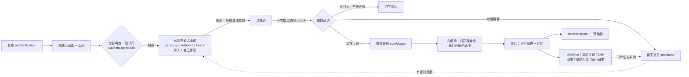
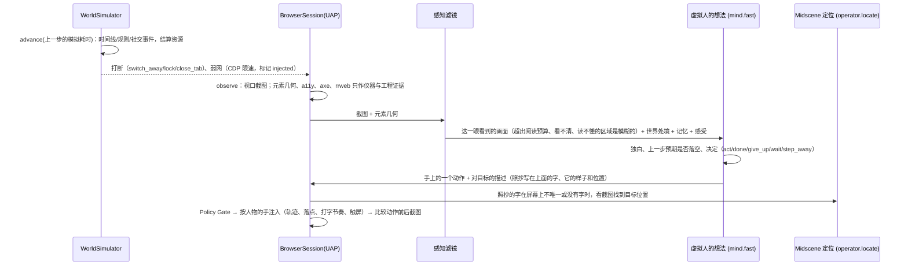

# 架构

> 产品决策：[`DECISIONS_2026-11-15.md`](DECISIONS_2026-11-15.md)。早期设计稿：[`SPEC_v0.2.md`](SPEC_v0.2.md)（其中「指派式评测」只作为内部校准保留）。本文描述**当前代码的实际实现**。

## 1. 部署形态

```
宿主机（pnpm / Node 24 原生运行）                     docker compose（只跑依赖）
┌──────────────────────────────────────────┐        ┌──────────────────────────────┐
│ apps/cli      jobs 命令行 + MCP 服务        │        │ postgres  pgvector/pg17      │ 55432
│ apps/api      REST + WebSocket + 网页       │──────▶ │ minio     S3 兼容证据存储     │ 59000/59001
│ apps/world    世界服务 + 发布引擎           │        │ litellm   模型网关（角色别名）│ 54000 ──▶ Vertex AI Gemini
│ apps/gateway  单端口网关 0.0.0.0:7777       │        │ nats      事件总线            │ 54222/58222
│ demos/kit     11 个示例产品（22 个实例）     │        │ tshock/tml 游戏服（profile game）│ 57777/57778
└──────────────────────────────────────────┘        └──────────────────────────────┘
```

- **唯一权威数据源**：Postgres（结构化数据）+ MinIO（截图、录像等大文件，按内容哈希寻址、只追加）。
- **谁在驱动**：世界服务。它推进时钟、日程与需求，并每 10 秒让发布引擎算一遍「这段时间里谁遇到了什么」；使用过程（浏览器会话）在世界服务进程内并发运行（`JW_CONCURRENCY`，默认 3；`JW_RUNNER=0` 关闭）。API 只读写数据库并经 NATS 向世界服务发命令。
- **模型**：系统内部只引用角色别名（`mind.fast`、`judge.meta` …），角色到模型的映射在 `config/pux.config.yaml` 与 `infra/litellm/config.yaml`。

## 1.1 发布主线（`packages/engine/src/launch/`）



| 模块 | 做什么 |
|---|---|
| `launch.ts` | `publishProduct`（建产品、拍商店页截图、建内部容器）、`setPromotion`、`launchFunnel`（按人去重的五层人数）、`storeListing` |
| `exposure.ts` | `audienceMatch`（投给谁）、`exposureChance`（每个渠道在这段时间里遇到的概率：宣发强度 × 手机在不在手边 × 是否投放对象 × 看腻了没有）、`notices`（注意到的概率）、`whatTheySee`（他在那个渠道里实际看到的样子）、`normFor`（每个渠道的常态）、`decide`（注意到之后由他自己说） |
| `engine.ts` | `LaunchEngine.tick`：先处理之前留下的念头（熟人提过、想以后看看、用过想再用），再算新的曝光；决定与使用都有并发上限；每累计几次使用后重新合成问题 |
| `usage.ts` | `startUsage`（把这个人此时此地的处境定下来，建一次使用）、`inviteToLaunch`（把手机递给人，标记为受邀）、`afterUse`（把用完后的打算落成评论、动态、口碑和回访念头） |
| `identity.ts` | 城里发的邮箱、手机号、惯用的用户名与密码、钱包；`deliverMail` 把验证邮件与短信送到对应的人；`payFromWallet` |
| `report.ts` | `gatherMoments`（每个人的关键时刻：第一眼、卡住、离开、办成、用完后说的话、评论与动态；路过没点开的人的想法）→ `launchReport`（`judge.meta` 归纳成一页，每条必须引用痕迹）；`experiencedIssues`、`engineeringAppendix` |

规则决定「遇没遇到、注没注意」，模型只在决定点出场：要不要点开、使用时的每一步、用完之后怎么说。数据：`launches`、`exposures`、`intentions`、`store_reviews`、`posts`、`mailbox`、`launch_reports`（迁移 `0007`）。每次发布内部对应一个 `studies` 行，作为使用过程、证据与花费的容器（`trigger = 'launch'`）。

指派式的批次（`control/study.ts` 的 `createStudy` / `runStudy`：按覆盖缺口采样「谁 × 目标 × 模式」）只留给内部校准：`jobs dev study …`。

## 2. 代码结构（十层逻辑分层 → 模块）

| 逻辑层（spec §3） | 代码位置 | 说明 |
|---|---|---|
| 发布主线 | `packages/engine/src/launch/`、`apps/world`、`apps/api`、`apps/cli` | 见 §1.1 |
| 内部校准批次 | `packages/engine/src/control/` | 指派式批次的生命周期与进程内编排、人工接管 |
| Product Intelligence | `packages/engine/src/product/intelligence.ts` | Playwright 爬取（遇登录墙自动注册测试账号）→ LLM 归纳 Feature/Task/Hypothesis → YAML 人工确认 → 入库；任务成功信号的客观判定 |
| Scenario & Exploration | `packages/engine/src/exploration/` | 生活目标（禁用测试类词汇）、四种模式、覆盖率（state/feature/task path/segment/scenario/hypothesis/issue/mode）、自适应采样、饱和停止 |
| Human Simulation | `packages/engine/src/human/` | 六层 Persona（YAML + zod 校验 + 版本哈希冻结）、MotorProfile、Dynamic State 规则引擎、感知滤镜、识字量模型、记忆（每人一棵 ewave 记忆树，`packages/memory`；身份钉住、对产品的态度有界可变、全局信念要多次独立经历才动）、生成流水线 |
| World Simulation | `packages/jobsworld/src/{life,context,residents}.ts`、`packages/engine/src/world/` | **合并世界**：一个人此时此地在城里的状态（地点、在做什么、需求、身边的人、城里的事件）由 `liveContextFor` 算成一份处境并写成世界模板；`WorldSimulator` 运行这份模板：模拟时钟、时间线、概率事件规则、Resource Model（时间/电量/金钱/注意力/网络）、Constraint Engine。YAML 场景模板只在显式指定 `world_ids` 时用于可复现的校准 |
| Simulation Runtime | `packages/engine/src/runtime/` | 每步：世界推进 → 打断/弱网注入 → 观察（截图）→ 感知滤镜 → 想法（只看图，输出手上的一个动作）→ 预期违背 → 状态更新 → 落点（看截图定位）→ Policy Gate → 按人物的手注入 → 护栏 |
| UAP 执行层 | `packages/executor/` | UAP v0.2（`packages/core/src/types/uap.ts`）；浏览器沙箱、成功标准判定、6 层错误分类、动作精度模型、Policy Gate、模态注入、录像/rrweb/HAR/axe |
| Evidence Engine | `packages/executor/src/evidence.ts`、`evidence`/`evidence_links`/`repro_paths` 表 | 统一登记（内容哈希）、多对象关联（primary/supporting/counter）、复现路径与重放 |
| Evaluation Engine | `packages/engine/src/evaluation/` | 客观评估、问题候选、评审团（先客观后独白两阶段）、AI 回答质量（含链接存在性客观检查）、事后访谈 + SUS/UMUX-Lite 模拟估计、干净重放、归因复核、问题合成、假设判定、分数聚合、模拟质量 |
| Calibration & Learning | `packages/engine/src/calibration/` | 已知缺陷注入（检出率/误报率 + Wilson CI）、真人基准（Spearman + 偏差方向 + 归一化方法验证）、埋点漏斗、评论；可信度分级；Learning 写回 `data/learning.json` |
| 结论 | `packages/engine/src/launch/report.ts`；`packages/engine/src/intelligence/report.ts` | 发布的一页结论（网页、命令行、MCP 共用）；校准批次的 Markdown / 离线 HTML 报告 |

## 3. 运行时序（一步）



## 4. 信息隔离（spec §4）

| 角色 | 实现方式 |
|---|---|
| 虚拟人的想法 | 输入只有「这一眼看到的画面」（感知滤镜处理后的截图）、地址栏、人物六层描述、处境、生活目标、自己的记忆与刚才做过的事；没有任何页面结构、元素列表或技术信号。生活目标生成时用正则拒绝「测试/评估/可用性/反馈」等词。系统提示词写明不懂软件内部、不改网址、不开开发者工具、不机械重试 |
| 落点 | 执行层只拿到人物对目标的描述；元素几何只用于把人物已经从画面里认出的目标换算成坐标（照抄的字唯一匹配时），其余由 Midscene 看截图定位。不会替人滚动 |
| Policy Gate | 在执行层（`checkPolicy`）硬拦截，不依赖提示词 |
| Evaluation | 全部在 Session 结束后运行；评审先只看客观时间线与截图，再看独白（两阶段，均入库） |
| 遇到产品 | 人物看到的只是那个渠道里的样子（商店卡片、广告、熟人的话），不含「测试、评估、体验官」之类的词；受邀时也只是「有人把手机递给你」 |

## 5. 关键设计决定与 spec 差异

| 项 | spec | 实现 | 原因 |
|---|---|---|---|
| 执行器 | Playwright + Midscene（推荐） | Playwright 启动浏览器 + **Midscene**（唯一的定位方式，只用 `aiLocate` 看截图找位置）；`playwright` 执行器只用于干净重放 | 2026-11-15 决策：Midscene 全家桶，删除 Stagehand |
| 感知 | Persona「看截图」，Operator 用 DOM/a11y | 人物只看截图；DOM 文字不进入想法；没有独立的 Operator 调用 | 2026-11-15 决策：想法纯视觉，落点可借 DOM |
| 问题清单 | 以问题清单为主 | 分两路：虚拟人亲历的体验问题；用户看不到的技术信号与专家检查进工程附录 | 2026-11-15 决策 |
| 厂商隔离 | 至少 2 家厂商 | 本机只有 Vertex Gemini：judge 用不同档位（argon/carbon/hydrogen）+ 不同审查视角；`vendor_isolation: warn` 时报告标注并降一级可信度 | 用户决定 |
| 录像 | Playwright 视频 | CDP screencast 帧 → ffmpeg 合成 mp4 | 沿用（帧率与体积可控） |
| HAR | Playwright HAR | 自采集请求日志（HAR-lite JSON） | 沿用 |
| MinIO 镜像 | — | `elestio/minio` | 官方镜像已停止在 Docker Hub 发布 |
| 可观测 | Langfuse | Postgres `llm_traces` 表（角色、别名、token、延迟、成本估算、状态，按 study/session/step 打标签） | 用户决定（本地轻量） |
| 语音注入 | TTS → fake audio | Vertex `gemini-3.8-flash-tts`（ADC 直连）→ ffmpeg 48k wav → `--use-file-for-fake-audio-capture`；失败回退 espeak | LiteLLM 暂不稳定支持 Vertex 音频输出 |
| 页面可见性打断 | 切标签页 | 注入脚本覆盖 `document.visibilityState` 并派发事件 + CDP `Page.setWebLifecycleState` 冻结 | headless 下切标签页不改变可见性 |

## 6. 关键机制补充

- **问题去重**：每轮聚类前，同一 axe 规则 + 同一页面模板的候选先确定性合并；LLM 聚类使用短编号；创建问题前与同版本、同类别的已有问题比较 embedding（cosine ≥ 0.86）以复用；finalize 时再做一次全量语义去重（`dedupeIssues`）。
- **人工分诊**：`jobs dev issue confirm|reject`；用于误报率下界与基线。
- **基线问题**：axe 客观检出、干净版本同 fingerprint、或复现路径在干净版本重放成功的问题不计入误报（见 `docs/CALIBRATION.md`）。
- **默认定位**：Persona 所在城市坐标 + 随机偏移；隐私敏感度 ≥ 0.75 的 Persona 拒绝定位授权。
- **感知滤镜**：只作用在图上。每一眼有阅读预算（`readingBudget`）；超出预算、字太小、对比度太低、认不全的区域被模糊；「瞥一眼」时屏幕下方约 45% 是余光；「凑近看」让一块区域清晰并附放大图。
- **设备跟着处境走**：同一个网页产品，在办公桌前用电脑开，在路上、沙发上、单手时用手机开（`deviceFor`）。
- **下拉框与原生弹窗**：系统级的选项列表和 alert/confirm 在无界面浏览器的截图里看不到，执行层分别用页面内列表和画到截图上的弹窗替代其显示。
- **信息隔离兜底**：给 Persona 侧使用的产品描述会剔除含测试/缺陷类词汇的句子。
- **模拟器错误不惩罚 Persona**：模拟器/执行器层的失败不计入预期违背与耐心消耗。

## 6.1 合并世界与人口（2026-11-15）

| 项 | 做法 |
|---|---|
| 使用时的处境 | `liveContextFor(personaId)`：世界时钟 → 当天日程的当前段 → 需求（从上次结算按日程推进到现在）→ 同一地点的家人、同事、朋友 → 设备与手眼耳嘴（`placeContext`）→ 还能用多久（到下一件不能耽误的事）→ 城里正在该地点发生的事件 → 世界模板 |
| 把手机递给谁 | 规划时随机抽一批居民看各自的处境；此刻有空的用此刻，没空的（睡觉、开车、上课）取他接下来第一个有空的时刻（`nextFreeContext`） |
| 城里的事件 | 管理员制造的事件写入 `world_events`；与使用时间重叠时进入该次使用的时间线：弱网（限速）、停电（断网并打断）、噪音与拥挤（分心）、下雨（户外的人去躲雨） |
| 时钟 | 世界服务驱动，默认 1:1；有人正在使用产品时最多 4×。一次使用内部的时间按人物的阅读、思考、操作耗时推进 |
| 人口 | 中国：家庭 → 年龄 → 学历 → 职业 → 收入的条件抽样（`config/population/zh-CN.json`）；英语区：Nemotron-Personas-USA 抽样行拼成家庭；数值由规则推导；模型按家庭写叙事 |
| 关系网 | 家人（同住）、同事与同学（同一工作地点分小组）、邻居（同楼相邻）、朋友（同语言、年龄相近） |
| 记忆与日子 | 记忆和态度的 `sim_day` 用世界的日子（自 2026-01-01 起的天数） |

## 7. 数据模型

见 `packages/db/src/schema.ts`（早期设计稿 §16 的实体，另加发布主线的 `launches`、`exposures`、`intentions`、`store_reviews`、`posts`、`mailbox`、`launch_reports`，以及 `issue_candidates`、`persona_global_state`、`human_tasks`、`llm_traces`、`executor_comparisons`、`app_verdicts`（历史表，不再写入））。`issue_candidates.track` 与 `issues.track` 区分 `experience`（亲历）与 `engineering`（工程附录）。迁移位于 `packages/db/migrations/`。

## 8. JobsWorld（城）

详见 [`JOBSWORLD.md`](JOBSWORLD.md)。要点：

- **一个世界**：一次使用发生在这个人此时此地在城里的处境里（`sessions.world_context` 记录地点、活动、设备、需求、身边的人和据此生成的世界模板）。处境由 `packages/jobsworld` 的纯规则计算，世界服务和引擎用同一套函数；引擎从 Postgres 读时钟（`world_kv`）、日程、需求和城里的事件，不要求世界服务在线。使用结束后，心情和压力写回这个人在城里的状态。
- **居民**：`households` / `residents` / `relations` 三张表。201 人、113 户；需求（饿、精力、孤单、压力、心情）按规则推进并改写日程；模型只用在决策点。
- **直播**：`apps/world` 每 1.5 秒只读轮询 Postgres 中正在进行的使用的新步骤，转成 NATS 事件；各产品的漏斗人数随发布引擎的每一轮广播（`jw.launches`）。
- **同一份城镇**：`config/jobsworld/town.yaml` → `computeLayout()`（`packages/jobsworld/src/town.ts`）生成渲染无关的图元与落脚点；网页小地图、TShock 插件、tModLoader mod 都从它渲染。
- **人物日程**：`persona_agendas` 表；规则骨架（`config/jobsworld/agenda.yaml`）+ `mind.slow` 补全意图与因果。
- **表**：`persona_agendas`、`persona_avatars`（迁移 `0002`）；`households`、`residents`、`relations`、`world_events`、`sessions.world_context`（`0005`）；`world_kv`（`0006`）。
- **入口**：`apps/gateway` 在一个端口上按首包分流 HTTP / 原版 Terraria / tModLoader。
