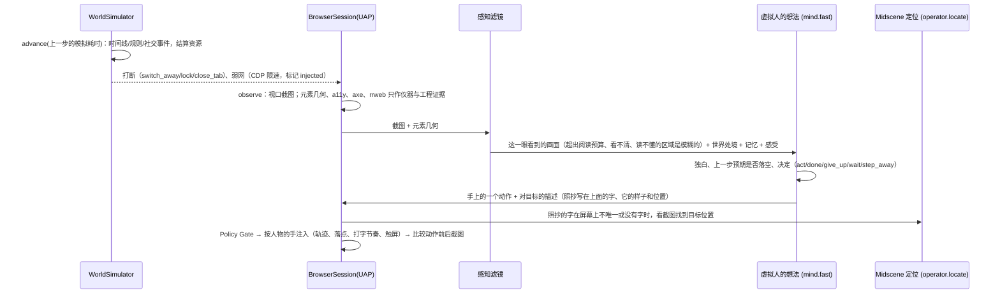

# 架构（本地 MVP 实现）

> 设计依据：[`docs/SPEC_v0.2.md`](SPEC_v0.2.md)（架构设计文档 v0.2）。本文描述**当前代码的实际实现**，以及与 spec 的差异。

## 1. 部署形态

```
宿主机（pnpm / Node 24 原生运行）                     docker compose（只跑依赖）
┌──────────────────────────────────────────┐        ┌──────────────────────────────┐
│ apps/cli      pux 命令行（主入口）          │        │ postgres  pgvector/pg17      │ 55432
│ apps/api      REST + WebSocket + 网页       │──────▶ │ minio     S3 兼容证据存储     │ 59000/59001
│ apps/worker   Temporal worker（可选编排）   │        │ litellm   模型网关（角色别名）│ 54000 ──▶ Vertex AI Gemini
│ apps/world    JobsWorld 世界服务            │        │ nats      JobsWorld 事件总线  │ 54222/58222
│ apps/gateway  单端口网关 0.0.0.0:7777       │        │ tshock/tml 游戏服（profile game）│ 57777/57778
│ demos/kit     11 个被测 Demo（22 个实例）    │        │ temporal  dev server + UI    │ 57233/58233
└──────────────────────────────────────────┘        └──────────────────────────────┘
```

- **唯一权威数据源**：Postgres（结构化数据）+ MinIO（截图、视频、rrweb、HAR 等大文件，按内容哈希寻址、只追加）。
- **编排**：两种等价模式。`inline`（进程内，默认，`pux study run`）与 `temporal`（`pux study run --temporal` + `pnpm worker`）。两者调用同一组引擎函数。
- **模型**：系统内部只引用 LiteLLM 角色别名（`mind.fast`、`judge.panel.0` …），角色到模型、厂商（family）的映射在 `config/pux.config.yaml` 与 `infra/litellm/config.yaml`。

## 2. 代码结构（十层逻辑分层 → 模块）

| 逻辑层（spec §3） | 代码位置 | 说明 |
|---|---|---|
| Experience Control Plane | `packages/engine/src/control/`、`apps/cli`、`apps/api`、`apps/worker` | Study 生命周期（幂等键）、规划、inline/Temporal 编排、人工接管 |
| Product Intelligence | `packages/engine/src/product/intelligence.ts` | Playwright 爬取（遇登录墙自动注册测试账号）→ LLM 归纳 Feature/Task/Hypothesis → YAML 人工确认 → 入库；任务成功信号的客观判定 |
| Scenario & Exploration | `packages/engine/src/exploration/` | 生活目标（禁用测试类词汇）、四种模式、覆盖率（state/feature/task path/segment/scenario/hypothesis/issue/mode）、自适应采样、饱和停止 |
| Human Simulation | `packages/engine/src/human/` | 六层 Persona（YAML + zod 校验 + 版本哈希冻结）、MotorProfile、Dynamic State 规则引擎、感知过滤、识字量模型、Generative-Agents 式记忆（pgvector）、生成流水线 |
| World Simulation | `packages/engine/src/world/simulator.ts` | 模拟时钟、Timeline、概率事件规则、Social Context、Resource Model（时间/电量/金钱/注意力/网络）、Constraint Engine（硬/软约束）、矩阵初始化器、因果链 caused_by、LLM 补充事件 |
| Simulation Runtime | `packages/engine/src/runtime/` | 每步：世界推进 → 打断/弱网注入 → 观察（截图）→ 感知滤镜 → 想法（只看图，输出手上的一个动作）→ 预期违背 → 状态更新 → 落点（看截图定位）→ Policy Gate → 按人物的手注入 → 护栏 |
| UAP 执行层 | `packages/executor/` | UAP v0.2（`packages/core/src/types/uap.ts`）；浏览器沙箱、成功标准判定、6 层错误分类、动作精度模型、Policy Gate、模态注入、录像/rrweb/HAR/axe |
| Evidence Engine | `packages/executor/src/evidence.ts`、`evidence`/`evidence_links`/`repro_paths` 表 | 统一登记（内容哈希）、多对象关联（primary/supporting/counter）、复现路径与重放 |
| Evaluation Engine | `packages/engine/src/evaluation/` | 客观评估、问题候选、评审团（先客观后独白两阶段）、AI 回答质量（含链接存在性客观检查）、事后访谈 + SUS/UMUX-Lite 模拟估计、干净重放、归因复核、问题合成、假设判定、分数聚合、模拟质量 |
| Calibration & Learning | `packages/engine/src/calibration/` | 已知缺陷注入（检出率/误报率 + Wilson CI）、真人基准（Spearman + 偏差方向 + 归一化方法验证）、埋点漏斗、评论；可信度分级；Learning 写回 `data/learning.json` |
| Experience Intelligence | `packages/engine/src/intelligence/report.ts` | 中英双语 Markdown 报告 + 离线 HTML 查看器（截图时间线、rrweb 回放、录像）、校准卡、热力矩阵、版本对比 |

## 3. 运行时序（一步）



## 4. 信息隔离（spec §4）

| 角色 | 实现方式 |
|---|---|
| 虚拟人的想法 | 输入只有「这一眼看到的画面」（感知滤镜处理后的截图）、地址栏、人物六层描述、处境、生活目标、自己的记忆与刚才做过的事；没有任何页面结构、元素列表或技术信号。生活目标生成时用正则拒绝「测试/评估/可用性/反馈」等词。系统提示词写明不懂软件内部、不改网址、不开开发者工具、不机械重试 |
| 落点 | 执行层只拿到人物对目标的描述；元素几何只用于把人物已经从画面里认出的目标换算成坐标（照抄的字唯一匹配时），其余由 Midscene 看截图定位。不会替人滚动 |
| Policy Gate | 在执行层（`checkPolicy`）硬拦截，不依赖提示词 |
| Evaluation | 全部在 Session 结束后运行；评审先只看客观时间线与截图，再看独白（两阶段，均入库） |
| Exploration | 只决定 persona × 世界 × 生活目标 × 模式，不向 Persona 透露任何测试意图 |

## 5. 关键设计决定与 spec 差异

| 项 | spec | 实现 | 原因 |
|---|---|---|---|
| 执行器 | Playwright + Midscene（推荐） | Playwright 启动浏览器 + **Midscene**（唯一的定位方式，只用 `aiLocate` 看截图找位置）；`playwright` 执行器只用于干净重放 | 2026-11-15 决策：Midscene 全家桶，删除 Stagehand |
| 感知 | Persona「看截图」，Operator 用 DOM/a11y | 人物只看截图；DOM 文字不进入想法；没有独立的 Operator 调用 | 2026-11-15 决策：想法纯视觉，落点可借 DOM |
| 问题清单 | 以问题清单为主 | 分两路：虚拟人亲历的体验问题；用户看不到的技术信号与专家检查进工程附录 | 2026-11-15 决策 |
| 厂商隔离 | 至少 2 家厂商 | 本机只有 Vertex Gemini：judge 用不同档位（argon/carbon/hydrogen）+ 不同审查视角；`vendor_isolation: warn` 时报告标注并降一级可信度 | 用户决定 |
| 录像 | Playwright 视频 | CDP screencast 帧 → ffmpeg 合成 mp4 | 沿用（帧率与体积可控） |
| HAR | Playwright HAR | 自采集请求日志（HAR-lite JSON） | 沿用 |
| MinIO 镜像 | — | `elestio/minio` | 官方镜像已停止在 Docker Hub 发布 |
| 可观测 | Langfuse | Postgres `llm_traces` 表（角色、别名、token、延迟、成本估算、状态，按 study/session/step 打标签） | 用户决定（本地轻量） |
| 语音注入 | TTS → fake audio | Vertex `gemini-3.8-flash-tts`（ADC 直连）→ ffmpeg 48k wav → `--use-file-for-fake-audio-capture`；失败回退 espeak | LiteLLM 暂不稳定支持 Vertex 音频输出 |
| 页面可见性打断 | 切标签页 | 注入脚本覆盖 `document.visibilityState` 并派发事件 + CDP `Page.setWebLifecycleState` 冻结 | headless 下切标签页不改变可见性 |

## 6. 关键机制补充

- **问题去重**：每轮聚类前，同一 axe 规则 + 同一页面模板的候选先确定性合并；LLM 聚类使用短编号；创建问题前与同版本、同类别的已有问题比较 embedding（cosine ≥ 0.86）以复用；finalize 时再做一次全量语义去重（`dedupeIssues`）。
- **人工分诊**：`pux issue confirm|reject` 或控制台 ✓/✗；用于误报率下界与基线。
- **基线问题**：axe 客观检出、干净版本同 fingerprint、或复现路径在干净版本重放成功的问题不计入误报（见 `docs/CALIBRATION.md`）。
- **默认定位**：Persona 所在城市坐标 + 随机偏移；隐私敏感度 ≥ 0.75 的 Persona 拒绝定位授权。
- **感知滤镜**：只作用在图上。每一眼有阅读预算（`readingBudget`）；超出预算、字太小、对比度太低、认不全的区域被模糊；「瞥一眼」时屏幕下方约 45% 是余光；「凑近看」让一块区域清晰并附放大图。
- **设备跟着处境走**：同一个网页产品，在办公桌前用电脑开，在路上、沙发上、单手时用手机开（`deviceFor`）。
- **下拉框与原生弹窗**：系统级的选项列表和 alert/confirm 在无界面浏览器的截图里看不到，执行层分别用页面内列表和画到截图上的弹窗替代其显示。
- **信息隔离兜底**：给 Persona 侧使用的产品描述会剔除含测试/缺陷类词汇的句子。
- **模拟器错误不惩罚 Persona**：模拟器/执行器层的失败不计入预期违背与耐心消耗。

## 7. 数据模型

见 `packages/db/src/schema.ts`（完整实现 spec §16 的全部实体，另加 `issue_candidates`、`persona_global_state`、`human_tasks`、`llm_traces`、`executor_comparisons`（历史表，不再写入））。`issue_candidates.track` 与 `issues.track` 区分 `experience`（亲历）与 `engineering`（工程附录）。迁移位于 `packages/db/migrations/`。

## 8. JobsWorld（可视化世界与工作台）

详见 [`JOBSWORLD.md`](JOBSWORLD.md)。要点：

- **解耦**：引擎不知道世界的存在。`apps/world` 每 1.5 秒只读轮询 Postgres 中正在运行的 Session 的新步骤，转成 NATS 事件；无论 Study 由 CLI、API 还是 Temporal 运行都能被看到。
- **同一份城镇**：`config/jobsworld/town.yaml` → `computeLayout()`（`packages/jobsworld/src/town.ts`）生成渲染无关的图元与落脚点；网页小地图、TShock 插件、tModLoader mod 都从它渲染。
- **人物日程**：`persona_agendas` 表；规则骨架（`config/jobsworld/agenda.yaml`）+ `mind.slow` 补全意图与因果。
- **新增表**：`persona_agendas`、`persona_avatars`、`app_verdicts`（迁移 `0002_jobsworld.sql`，只新增）。
- **入口**：`apps/gateway` 在一个端口上按首包分流 HTTP / 原版 Terraria / tModLoader。
