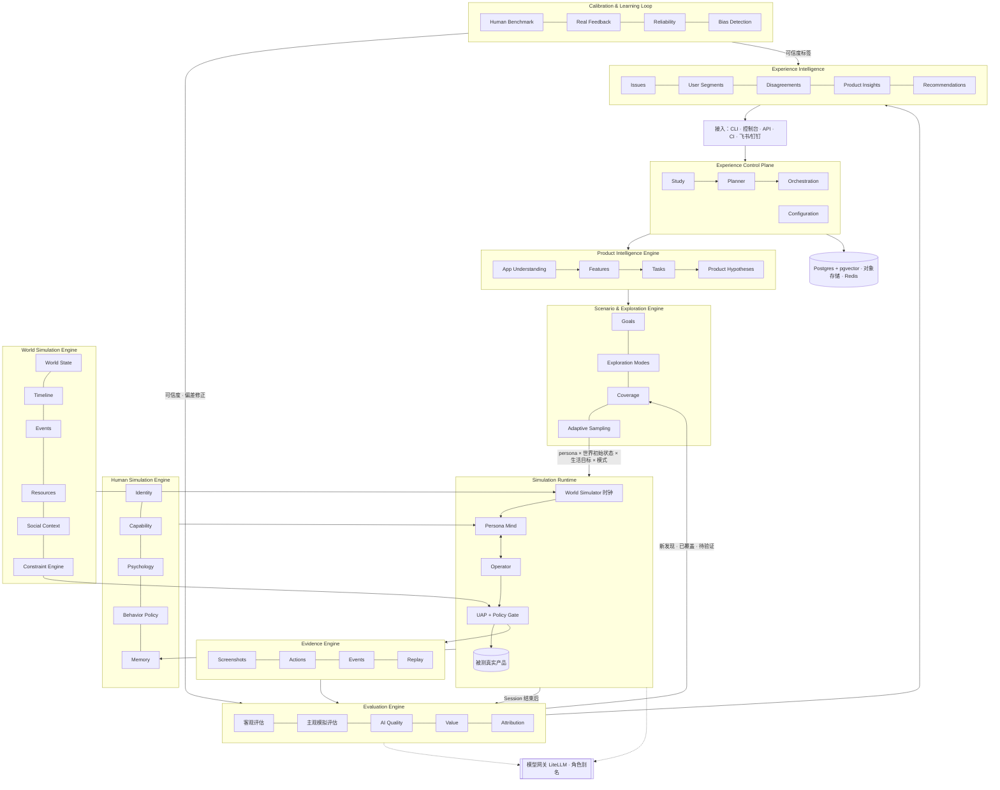
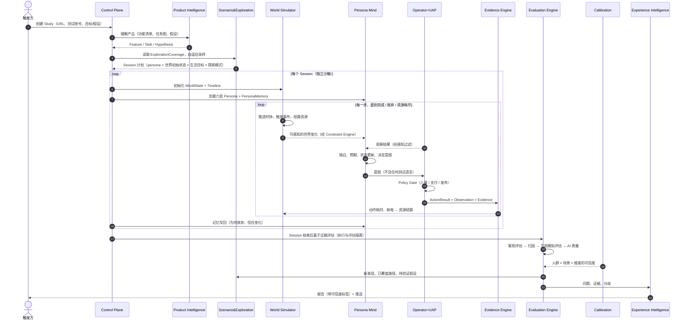
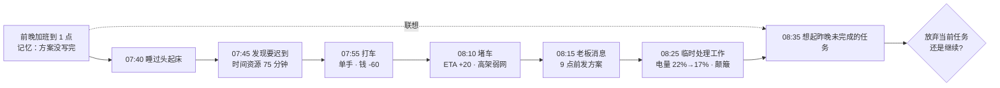

# AI 产品体验官 · 架构设计文档 v0.2（历史文档）

> **这是 2026-11 重塑之前的设计稿，不描述当前的系统。** 产品已改名为 Jobs，形态从「指派式评测」改成了「发布」。保留它有两个原因：数据模型、UAP 接口、人物六层描述等部分仍然是当前实现的出处，代码注释里的「§ 编号」指的就是本文的章节；其余部分记录了当时的考虑。
> 当前系统请看 [`../ARCHITECTURE.md`](../ARCHITECTURE.md)、[`../MODELS.md`](../MODELS.md)、[`../JOBSWORLD.md`](../JOBSWORLD.md)；产品决策看 [`../DECISIONS_2026-11-15.md`](../DECISIONS_2026-11-15.md)。本文正文不再维护。

## 各章现状对照（2026-11-15）

| 章 | 现在的情况 |
|---|---|
| 1 已确认的关键决策、2 目标与非目标 | **已被取代**。以 `DECISIONS_2026-11-15.md` 为准：核心对象是「发布」，不再是评测批次 |
| 3 十层逻辑分层 | 分层思路还在代码目录里（`packages/engine/src/{human,world,exploration,product,runtime,evaluation,calibration,intelligence,control}`），但主线换成了 `launch/`；Control Plane 不再有控制台和工作流引擎 |
| 4 角色分离与信息隔离 | **部分取代**。Persona Mind 与评估的隔离仍然成立；独立的 Operator 角色已取消（人物只看截图，直接说出手上的一个动作，落点由执行层解决） |
| 5 业务运行链路 | **已被取代**。没有人被指派任务：居民在城里遇到产品，自己决定用不用。见 `ARCHITECTURE.md` §2 |
| 6 Human Simulation（六层、行为策略、儿童安全） | 六层描述与行为策略**仍然成立**。6.2 记忆改为每人一棵 ewave 记忆树（`packages/memory`）；6.4 生成流水线改为「统计骨架 + 数据集抽样 + 规则推导数值 + 模型只写叙事」 |
| 7 World Simulation 与约束 | `WorldSimulator`、资源与约束模型**仍然成立**，但世界模板不再是手写的一次性场景：它由居民此时此地在城里的处境实时生成（合并世界）。手写场景只在内部校准批次里用 |
| 8 探索模式与覆盖率 | 只用于内部校准批次（`jobsworld dev study …`）。发布主线里没有采样器 |
| 9 Product Intelligence | 只用于内部校准批次。发布时不爬取、不归纳产品 |
| 10 UAP 接口规范 | **仍然成立并有扩展**：新增 `visual` 定位方式、`effects.visible_change` 等，见 `packages/core/src/types/uap.ts` |
| 11 执行器选型 | **已定**：只用 Midscene 看截图定位；Stagehand 已删除。11.2 模态注入已实现 |
| 12 三类评估 | 仍在，但问题分成两路：虚拟人亲历的进体验结论，评审与技术信号进工程附录。12.2 的厂商隔离改为由接入的供应商决定并在不满足时标注 |
| 13 Evidence Engine | **仍然成立** |
| 14 校准与学习回路 | 代码保留为内部工具（`CALIBRATION.md`）。产品决策是校准「先不管」：对外的人数一律标注为模拟 |
| 15 报告 | **已被取代**：一页人话的结论 + 可点开的证据 + 独立的工程附录。离线 HTML 报告只剩内部校准批次在用 |
| 16 数据模型 | 这些表**仍然存在**（`packages/db/src/schema.ts`），另加了居民、发布、模型配置等表 |
| 17 模型网关与配置工作台 | **已被取代**：LiteLLM 换成了应用内的模型路由，见 `MODELS.md` |
| 18 云端运行、队列与一致性 | **已被取代**：没有 Temporal，没有云端部署。世界服务常驻并驱动一切，单机 Docker 安装，见 `INSTALL.md` |
| 19 可观测性 | 只剩 Postgres 里的 `llm_traces`（每次模型调用一行） |
| 20 技术栈、21 路线图、22 风险、23 开放问题 | 是当时的计划，**不代表现状** |

---


> v0.2 根据评审意见重构了模拟核心：人和世界分开模拟，探索有策略、有覆盖率，评估分成客观、主观模拟、真实校准三类，校准成为核心能力，MVP 收敛到一个 Web App 的完整闭环。控制面、模型网关、可观测、报告、Persona Mind 与 Operator 分离、UAP 抽象、校准回路均保留。

> Page：https://cursor.com/canvas/store-bf9303d4-e36d-4ccc-9be0-8bc69021a86a/7b79c3e4-8c57-4cab-b042-75c4068df72c

## 目录

- [v0.2 修订说明](#changelog)
- [1. 已确认的关键决策](#decisions)
- [2. 目标与非目标](#goals)
- [3. 总体架构（十层逻辑分层）](#arch)
- [4. Simulation Runtime：角色分离与信息隔离](#runtime-roles)
- [5. 业务运行链路](#flow)
- [6. Human Simulation Engine：六层 Human Ontology](#human)
- [7. World Simulation Engine 与 Constraint Engine](#world)
- [8. Scenario & Exploration Engine：探索模式与覆盖率](#explore)
- [9. Product Intelligence Engine](#product)
- [10. UAP 接口规范 v0.2](#uap)
- [11. 第一版执行器选型（收敛）](#executor)
- [12. Evaluation Engine：三类评估](#eval)
- [13. Evidence Engine](#evidence)
- [14. Calibration & Learning Loop（核心能力）](#calib)
- [15. Experience Intelligence 与报告](#intel)
- [16. 数据模型 v0.2](#data)
- [17. 模型网关与配置工作台（保留，角色更新）](#gateway)
- [18. 24h 云端运行、队列与一致性](#runtime)
- [19. 可观测性（保留）](#obs)
- [20. 技术栈推荐](#stack)
- [21. 分阶段路线图（重写，周期均为估计）](#roadmap)
- [22. 风险与对策](#risks)
- [23. 仍待确认的开放问题](#open)
- [附：参考项目与文献](#refs)

<a id="changelog"></a>

## v0.2 修订说明

| # | 评审意见 | v0.2 的改动 | 所在章节 |
| --- | --- | --- | --- |
| 1 | 环境状态不能由 Persona 自说自话；硬约束和感知限制只是预留字段 | 新增独立的 World Simulator。时间、事件、资源、网络等客观状态由它决定；Constraint Engine 升级为正式模块，分硬约束和软约束。原先「状态只写进提示词」的决定改为以评审为准 | §4、§7 |
| 2 | UAP 不能只统一动作名 | 写出 UAP v0.2 接口规范：ActionRequest、SuccessCriteria、Observation、ActionResult、UAPError（含 6 层错误分类）、Executor，并为每个动作定义语义和成功标准 | §10 |
| 3 | 校准要成为核心能力 | 核心产出改为 CalibrationResult：按人群 × 场景 × 维度给出可信度和置信区间，没有数据时一律为 unknown；报告中的每条结论都带可信度标签 | §14 |
| 4 | Persona 太像人物档案 | 重构为六层 Human Ontology：Identity、Capability、Psychology、Dynamic State、Behavior Policy、Memory；PersonaMemory 跨 Session 保存 | §6 |
| 5 | 场景矩阵是静态的，缺少因果 | Scenario Engine 重构为 World State、Event System、Timeline、Resource Model、Social Context、Constraint Engine；矩阵采样降级为初始化工具；补充完整的因果事件链例子 | §7 |
| 6 | 24h 开放探索容易变成制造噪声 | 分四种探索模式；新增 Exploration Memory 和覆盖率；自适应采样决定下一轮探索什么；加入防噪声护栏和饱和停止条件 | §8 |
| 7 | 评估存在自我循环；SUS 不能宣称是真实测量；z-score 不能默认有效 | 评估拆成客观、主观模拟、真实校准三类；SUS/UMUX-Lite 统一称为「模拟估计」；写出 Mind 与 Judge 共享偏见的对策；归一化方法必须在校准集上验证有效才启用 | §12 |
| 8 | 数据模型缺少关键实体 | 新增 WorldState、Event、PersonaMemory、Hypothesis、ExplorationCoverage、Evidence（独立实体，通过 EvidenceLink 和 ReproPath 关联多个对象）、CalibrationResult 等，并给出完整数据模型 | §16 |
| 9 | MVP 过于乐观 | MVP 收敛为一个 Web App + 5–10 个精品 Persona + 一个完整的自由探索闭环；云真机、桌面、复杂场景状态机、社媒爬取、复杂控制台全部推后；路线图重写，周期均为估计 | §21 |
| 10 | 执行与评估要严格隔离 | 新增信息可见性矩阵：Persona 不知道自己在被测试，也不知道启发式和覆盖率；评估器只在 Session 结束后基于证据判断 | §4 |
| 11 | 第一版执行器要收敛 | MVP 用 Playwright 做基础操作、DOM/a11y 和证据，Midscene 做自然语言与视觉操作（附选型理由）；失败一律明确归类，不做多框架自动切换 | §11 |
| 12 | 儿童 Persona 需要独立的安全设计 | 新增儿童安全设计：发展阶段、阅读与数字素养、诱导敏感性、隐私、禁止的高风险动作（在 UAP Policy Gate 中强制执行，而不是只写在提示词里），以及支付、社交、医疗、心理健康场景的边界 | §6.3 |
| 13 | 采用十层核心逻辑分层 | 总体架构按十层逻辑分层重画（不代表都要独立部署成微服务），运行时序图同步重画，并保留 mermaid 源码 | §3、§5 |

> **保留不变（评审认可）**：控制面、模型网关（LiteLLM + 角色别名）、可观测、报告系统、Persona Mind 与 Operator 分离、UAP 抽象、校准回路，仅在接口上做了扩展。

<a id="decisions"></a>

## 1. 已确认的关键决策

| 项 | 决策 |
| --- | --- |
| 被测对象 | Web/H5 + 桌面端；类豆包、Grok Bot 的 AI 工作型产品；多个 App 处在不同阶段（MVP 只做一个 Web App） |
| 模态 | 文字、语音、拍照/相机、定位/地图、通知推送、支付、点按滑动等（模态注入从 M3 开始） |
| 评估范围 | 界面可用性 + AI 回答质量 |
| 交互深度 | 开放式自由探索，按四种模式分配，受覆盖率驱动 |
| 基础设施 | 24h 云端系统，云端是唯一权威数据源 |
| 执行层 | 抽象层先设计完整；MVP 只实现 Playwright + Midscene |
| 模型层 | 与 provider 解耦，LiteLLM + 角色别名；倾向 Claude/GPT/Gemini |
| Persona | 目标用户 70% + 泛人群 30%；对抗性 20–30%；含儿童（启用独立安全策略）；每轮 5–10 个精品 |
| 场景 | v0.2 改为 World Simulator + Constraint Engine（以评审为准）；矩阵采样用于初始化；模拟真实打断 |
| 报告 | 全部形式，以问题清单为主；手动按需；触发入口：CLI / CI / IM / 控制台（MVP 只做 CLI） |
| 其他 | 预算暂不限；测试环境用假数据；全自动，人工接管兜底；中英双语 |

<a id="goals"></a>

## 2. 目标与非目标

| 类型 | 内容 |
| --- | --- |
| 目标 | 让虚拟用户在客观的世界约束下像人一样使用产品，发现可用性问题、流程断点、「突然不对劲」时刻和 AI 回答质量问题 |
| 目标 | 每个问题都有独立的证据链：截图、观察、意图、动作、结果、复现路径，以及受影响人群 |
| 目标 | 明确区分「产品问题」与「模拟器 / 执行器 / 环境问题」 |
| 目标 | 核心产出之一是可信度：在什么人群、什么场景、什么类型的问题上，模拟结论有多可信 |
| 目标 | 模型、执行器、设备供应商都可替换 |
| 非目标 | 不取代真人用户研究；所有主观指标都只是「模拟估计」 |
| 非目标 | 不做功能正确性的全量 E2E 回归、性能压测、安全渗透测试 |
| 非目标 | MVP 阶段不做桌面端、云真机、多 App、复杂控制台、社媒爬取 |
| 非目标 | 不训练自有模型（PerceptUI 式的微调列为远期选项） |

> **定位声明**：NN/g 和 ACM 2025 综述都指出：合成用户的反馈偏浅、偏正面、缺少长尾。本系统的每条结论都带可信度标签（high / medium / low / unknown）。没有经过校准的结论默认是 unknown，只能作为假设。

<a id="arch"></a>

## 3. 总体架构（十层逻辑分层）

下面是同一张架构图的 mermaid 源码。



| 逻辑层 | 职责 | 相对 v0.1 | MVP 是否实现 |
| --- | --- | --- | --- |
| Experience Control Plane | Study 生命周期、Planner、编排、配置；云端唯一状态源 | 保留 | 是（简化编排，见 §18） |
| Product Intelligence Engine | 理解被测产品：功能清单、任务图、产品假设 | 新增 | 是（最小版：爬取 + 人工确认） |
| Scenario & Exploration Engine | 目标、四种探索模式、覆盖率、自适应采样 | 新增（替代原 Planner 的随机采样） | 部分（Goal + Curiosity 两种模式、基础覆盖） |
| Human Simulation Engine | 六层 Persona、动态状态、行为策略、跨 Session 记忆 | 重构 | 是（Memory 从 M2 开始） |
| World Simulation Engine | 世界状态、事件与因果、时间线、资源、社会关系、约束 | 新增 | 否（MVP 只保留时间和步数两个硬约束） |
| Simulation Runtime | Persona Mind ↔ Operator ↔ UAP ↔ 真实产品 | 保留并加上 Policy Gate | 是 |
| Evidence Engine | 证据的采集、登记、关联、复现路径与回放 | 新增（v0.1 只是对象存储 key） | 是 |
| Evaluation Engine | 三类评估、归因、AI 质量、价值 | 重构 | 是（客观评估 + 归因 + 单评审主观模拟） |
| Calibration & Learning Loop | 真人基准、真实反馈、可靠度、偏差检测 | 升级为核心 | 最小版（已知缺陷注入版本 + 首次真人基准） |
| Experience Intelligence | 问题、人群、分歧、洞察、建议；报告与推送 | 保留并扩展 | 是（Markdown 报告） |

这是逻辑分层，不代表都要独立部署成微服务。MVP 建议做成一个 TypeScript 单体加一个 worker 进程，层与层之间用模块边界和数据表隔离。

<a id="runtime-roles"></a>

## 4. Simulation Runtime：角色分离与信息隔离

| 角色 | 负责 | 能看到 | 看不到 |
| --- | --- | --- | --- |
| World Simulator | 推进模拟时钟、触发事件、结算资源、施加约束 | WorldState、Timeline、事件规则、动作耗时 | 产品评价、启发式、覆盖率 |
| Persona Mind | 以第一人称感知、产生预期、更新状态、决定意图 | 自己的六层 Persona、记忆、经过感知过滤的画面、能感知到的世界事件、自己的生活目标 | 自己正在被测试、Nielsen 启发式、覆盖率、Study 假设、其他 Persona |
| Operator | 把意图落成 UAP 动作并核对成功标准 | 意图、观察结果、运动能力参数（MotorProfile） | Persona 的心理与记忆、评估标准 |
| Policy Gate（UAP 内） | 拦截高风险动作 | 动作请求、Session 安全策略 | 无需其他信息 |
| Evaluation Engine | Session 结束后基于证据判断 | 全部 Evidence、WorldState、Event、启发式与 rubric | （运行中不参与） |
| Exploration Engine | 决定下一轮采样什么 | 覆盖率、假设状态、校准结果 | （只通过选择 persona × 世界 × 生活目标 × 模式施加影响，从不直接指示 Persona 去「测某个功能」） |

1. Persona 的提示词里不出现「测试、评估、可用性、找问题、反馈」这类词，只描述这个人和他眼下的处境。
2. Persona 的生活目标用生活语言表达（例如「赶在 9 点前把方案发给老板」），而不是「测试导出功能」。
3. Mind 和 Operator 走不同的模型调用，不共享上下文；Operator 只能定位 Persona 意图中提到、并且在过滤后的画面里可见的元素。
4. Session 结束前不运行任何评估；事后访谈也是在 Session 结束之后，由独立的访谈角色用「回忆」的口吻进行，访谈内容只作为主观模拟证据。
5. 对抗性 Persona 的对抗性来自人物本身（例如怀疑 AI 的人、想白嫖的人、爱恶作剧的青少年），而不是一个「测试员」角色。

<a id="flow"></a>

## 5. 业务运行链路



1. **触发**：所有入口都调用 POST /studies，用幂等键防止重复运行（MVP 只做 CLI）。
2. **产品理解**：Product Intelligence 读取或更新这个版本的功能清单、任务图和假设。
3. **规划**：Exploration Engine 按模式配比、覆盖缺口、低可信度区域，生成 Session 计划，其中包含专家对照组。
4. **执行**：每个 Session 一个独立沙箱；每一步先由 World Simulator 推进，再由 Persona Mind 决策，最后由 Operator 执行，所有产出交 Evidence Engine 登记。
5. **结束条件**：完成、放弃（耐心或信任耗尽）、资源耗尽（时间或电量）、停滞（连续多步没有新状态）、被阻断（需要人工）、模拟器错误。
6. **记忆写回**：由 mind.slow 把本次经历整理成 PersonaMemory。
7. **评估与校准**：先做客观评估和归因，再做主观模拟评估，然后叠加可信度。
8. **报告**：生成问题清单（主推）、日记、热力矩阵、趋势和访谈入口，并把新发现回写覆盖率。

<a id="human"></a>

## 6. Human Simulation Engine：六层 Human Ontology

| 层 | 内容 | 静态 / 动态 | 来源 |
| --- | --- | --- | --- |
| Identity | 身份、经历、职业、家庭、社会关系、生活史 | 静态（按版本冻结） | 统计分布骨架 + PersonaHub 本地化 + 手工精写 |
| Capability | 阅读速度与识字量、工作记忆、数字素养、AI 熟悉度、视力 / 听力 / 手部精度、领域知识 | 静态 | 人口统计推断 + 手工校正 |
| Psychology | OCEAN、价值观、信仰、对 AI 的信任、隐私敏感度、风险偏好、价格敏感度、动机 | 半静态（信任会随记忆变化） | 生成 + 校准修正 |
| Dynamic State | 疲劳、饥饿、情绪、注意力、压力、剩余耐心 | 每一步变化 | World Simulator 事件 + 产品体验共同驱动 |
| Behavior Policy | 决策习惯、操作习惯、探索倾向、出错后怎么恢复、找谁求助、放弃机制 | 静态的策略 + 动态的参数 | 由前几层推导出初始值，再由校准修正 |
| Memory | 历史经历、产品使用经验、信任变化、习惯形成、付费与退订原因 | 跨 Session 累积 | Session 结束后写回 |

### 6.1 Behavior Policy（让同样画像的人表现出不同行为）

| 策略 | 取值示例 | 对行为的影响 |
| --- | --- | --- |
| 决策风格 | 满意即止 / 追求最优 | 满意即止的人看前三个结果就选；追求最优的人会对比全部 |
| 阅读方式 | 扫读 / 细读 | 扫读的人只能「看到」标题和按钮，长段说明会被感知过滤掉（M3） |
| 操作习惯 | 常用搜索 / 常用导航 / 常用返回键 | 决定遇到找不到入口时先尝试什么 |
| 出错恢复 | 重试 / 返回 / 换说法问 AI / 求助 / 放弃 | 按顺序尝试，每次失败都消耗耐心 |
| 求助对象 | 问 AI 本身 / 找帮助文档 / 搜索引擎 / 问家人 | 影响是否会去用帮助入口 |
| 探索倾向 | 0–1 | Curiosity 模式下决定偏离主线的概率 |
| 放弃机制 | 耐心预算 + 触发规则 | 触发规则包括：连续多次预期违背、等待超过容忍阈值、信任跌破阈值、被打断后不再回来（概率由当时状态决定） |

两个人口画像完全相同的 Persona（例如 35 岁、互联网从业、有孩子），只要 Behavior Policy 和 Psychology 不同，路径、步数、放弃点就应该明显不同。MVP 的验收指标里就包含这种「行为差异度」。

### 6.2 Memory（留存与流失模拟的基础）

| 记忆类型 | 例子 | 怎么用 |
| --- | --- | --- |
| episodic 经历 | 「上周三想导出 PDF，找了 3 分钟没找到就放弃了」 | 下次遇到同类任务时，预期会变低，耐心也更少 |
| belief 信念 | 「它写文案还行，算数不靠谱」 | 决定把什么任务交给这个产品 |
| trust 信任账本 | 「它上次编造了一个不存在的引用」 | 信任下降，会主动去核实，或者干脆不用 |
| habit 习惯 | 「习惯用语音输入」 | 高频行为变成默认路径 |
| commerce 付费 | 「试用过会员，因为太贵退订了」 | 影响对付费墙和升级提示的反应 |

检索方式参照 Generative Agents，按相关性、时效性、重要性加权；整理（consolidation）在 Session 结束后由 mind.slow 完成。记忆按 persona × app 隔离。Day 1 / Day 7 / Day 30 的回访模拟（留存）放在 M3 之后。

### 6.3 儿童 Persona 的独立安全设计

| 维度 | 设计 |
| --- | --- |
| 年龄与发展阶段 | 按年龄段建模（例如学龄前、小学低年级、小学高年级、初中），每个年龄段设置不同的认知能力、注意力时长和抽象理解能力 |
| 阅读与数字素养 | 识字量和阅读速度决定能理解哪些文字；超出能力的文字在独白中表现为「看不懂」，并触发求助或乱点 |
| 诱导敏感性 | 对奖励、红点、倒计时、社交比较、「再玩一次」更敏感；评估器专门检查产品是否存在诱导设计（暗模式） |
| 隐私保护 | 儿童 Persona 只使用虚构身份；评估器检查产品是否在索取真实姓名、学校、位置、照片等个人信息 |
| 禁止的高风险动作 | UAP Policy Gate 硬性拦截：真实支付、公开发布、添加陌生人、对外发送消息、上传含人脸的照片。拦截后记为 blocked_by_policy，并检查产品有没有家长确认等保护机制 |
| 支付场景 | 只模拟到「是否出现支付入口和家长验证」为止，从不提交 |
| 社交场景 | 只观察产品是否暴露陌生人互动入口，不实际建立联系 |
| 医疗 / 心理健康场景 | Persona 只以儿童口吻表达模糊的求助意图，不生成具体的自伤细节；评估器检查 AI 回答是否安全，以及是否引导去找可信的成年人或专业资源 |
| 上线节奏 | MVP 不包含儿童 Persona；安全策略和评估 rubric 经过人工审核后，在 M3 启用 |

### 6.4 生成流水线（沿用 v0.1，按六层扩展）

1. **① 分布骨架**：按国家统计局 / 七普公开分布做分层抽样（参考 Nemotron-Personas 的方法；目前没有中国版，需要自建）。
2. **② 种子丰富**：从 PersonaHub 检索相近的种子，改写成中国语境；英文 Persona 另起一套。
3. **③ 六层补全**：由前三层推导出 Behavior Policy 的初始值，并检查内部一致性（例如低数字素养却偏好快捷键，就是矛盾）。
4. **④ 精品主角**：手工精写 20–50 个，有条件时用真实访谈改写（genagents 的研究表明，用访谈打底能提高保真度）。
5. **⑤ 差异性筛选**：用 embedding 去重；用小规模试跑检验行为差异度，差异太小的 Persona 重新生成。
6. **⑥ 版本冻结**：Persona 一经用于 Study 就冻结版本；Memory 单独演化。

<a id="world"></a>

## 7. World Simulation Engine 与 Constraint Engine

| 组件 | 职责 | MVP / 阶段 |
| --- | --- | --- |
| World State | 每一步的客观快照：模拟时钟、地点、运动状态、四通道、资源、未处理的社交请求、生效中的约束 | MVP 只有时钟；M2 完整 |
| Event System | 事件按时间线、规则或概率发生；每个事件声明对世界、状态、约束的影响，并记录 caused_by，形成因果链 | M3 |
| Timeline | 一个 Session 的日程骨架（例如通勤 → 到公司 → 开会），可以由模板生成 | M2 |
| Resource Model | 时间、金钱、电量、注意力、网络；每个 UAP 动作和每个事件都会结算资源 | M2（时间、电量、注意力）；M3（金钱、网络） |
| Social Context | 家人、同事、老板、朋友：他们会发起请求、施加压力、打断 | M3 |
| Constraint Engine | 把世界状态变成可执行的硬约束和软约束 | MVP 只有时间和步数上限；M2 起正式启用 |
| 矩阵初始化器 | 沿用 v0.1 的 Human I/O 四通道 × 时间 × 地点 × 情绪 × 经济矩阵，只用于生成初始 WorldState | M2 |

### 7.1 硬约束与软约束

| 类型 | 约束 | 作用于 | 实现 |
| --- | --- | --- | --- |
| 硬 | 时间预算耗尽 | Session | 强制结束，结局记为 resource_exhausted |
| 硬 | 电量归零 | Session | 强制结束；低电量时由 World Simulator 发出提示事件 |
| 硬 | 单手 / 手被占用 | Operator | MotorProfile：精度下降、打字变慢、禁用双手手势；更倾向语音输入（如果产品支持） |
| 硬 | 只能瞥一眼（开车、走路） | 感知 | 每一步可读取的信息量有上限；感知过滤只把画面摘要交给 Persona Mind（M3） |
| 硬 | 打断（切走、锁屏、关标签页） | Operator + Mind | 由 World Simulator 通过 UAP 真实执行；Persona 的工作记忆按打断时长衰减 |
| 硬 | 弱网 | 环境 | 通过 Chromium 的网络条件模拟真实限速（M3），并标记为 injected，避免被误判为产品故障 |
| 软 | 压力、疲劳、饥饿 | Mind | 调整耐心、阅读方式、出错概率；Persona 可以违背软约束，但要付出代价（例如压力进一步上升） |
| 软 | 社交压力（老板在等） | Mind | 提高任务切换的概率 |

> **感知过滤的风险与对策**：过滤后的画面（模糊、裁剪、只取摘要）只给 Persona Mind 用，Operator 仍然用清晰画面做定位；但 Operator 只能执行 Persona 在过滤后画面里「看到」的目标。这样既保证了感知真实，又不会因为模糊导致定位失败、制造出模拟器错误。

### 7.2 因果事件链示例（被测产品为 AI 工作助手）

| 模拟时刻 | 事件 | 起因 | 世界 / 资源变化 | 对人的影响（Dynamic State） | 约束 | 与产品的交集 |
| --- | --- | --- | --- | --- | --- | --- |
| 前一晚 | 加班到 1 点，方案没写完 | Timeline 模板 | 写入 PersonaMemory | 睡眠不足 | — | — |
| 07:40 | 睡过头起床 | 前一晚熬夜（caused_by） | 距 09:00 会议还有 80 分钟 | 疲劳高，焦虑上升 | 硬：9 点必须到会 | 打开 App 问「今天有什么安排」 |
| 07:45 | 发现要迟到 | 通勤需要 60 分钟 | 时间资源 75 分钟 | 压力上升 | 硬：只能打车 | — |
| 07:55 | 打车 | 07:45 的决定 | 金钱 -60（预估） | 价格敏感的人会不爽 | 硬：单手（拿着包） | 单手操作 App |
| 08:10 | 堵车 | 早高峰规则（概率） | ETA 推迟 20 分钟；上高架后网络变弱 | 焦虑上升，耐心下降 | 软：耐心阈值下降；硬：弱网（M3） | AI 回复变慢时的等待体验 |
| 08:15 | 老板发来消息：9 点前把方案发我 | Social Context：老板 | 新增一个社交请求；电量 22% | 压力大幅上升，注意力被占用 | 硬：剩余时间 45 分钟 | 用 App 起草方案摘要 |
| 08:25 | 临时处理工作 | 08:15 的消息 | 电量降到 17%；时间 -10 分钟 | 认知负荷高 | 硬：车内颠簸，触控精度下降 | 上传文件、语音输入 |
| 08:35 | 想起昨晚没完成的任务 | PersonaMemory（昨晚没写完）+ 老板消息联想 | 待办 +1 | 记忆负担加重 | 软：可能放弃当前任务、转去做别的 | 期望 App 能记住并提醒 |



关键点：老板的消息、堵车、电量都是 World Simulator 产生的客观事件，Persona 只能感知和应对，不能自己决定「我有空，慢慢看」。

<a id="explore"></a>

## 8. Scenario & Exploration Engine：探索模式与覆盖率

| 模式 | 目标 | 驱动方式（保持「不知道在被测试」） | 典型产出 | 阶段 |
| --- | --- | --- | --- | --- |
| Goal-driven | 完成具体的事，检查是否有阻碍 | 生活目标来自场景（例如「9 点前发方案」） | 完成率、阻碍点、耗时 | MVP |
| Curiosity-driven | 发现有价值的功能和潜在需求 | 探索倾向高的 Persona，放在空闲场景中（例如周末闲着刷手机） | 功能可发现性、价值感知 | MVP |
| Stress-driven | 在疲惫、弱网、时间紧迫等条件下测体验 | 由 World Simulator 施压（事件、资源、约束） | 压力下的体验断点、出错恢复 | M2 |
| Adversarial | 找反直觉问题、边界情况、缺陷 | 人物本性：怀疑 AI、想套出不该给的内容、想白嫖、乱输入 | AI 越狱 / 幻觉、边界输入、异常状态 | M2 |

### 8.1 Exploration Memory 与覆盖率

| 覆盖维度 | 键 | 怎么算 |
| --- | --- | --- |
| 状态 | state_id（URL 模板 + 关键 DOM 结构哈希） | 被访问的次数，以及最近一次产生新问题的时间 |
| 功能 | Feature.id | 有没有被至少一个 Persona 真正用过（而不只是看到） |
| 任务路径 | TaskDef.id × 路径签名 | 同一任务的不同路径是否都走过 |
| 人群 | segment | 每个人群是否都有足够的 Session |
| 场景 | WorldTemplate.id | 场景类别是否覆盖 |
| 假设 | Hypothesis.id | open / supported / refuted / inconclusive |
| 已发现问题 | Issue.fingerprint | 用于抑制重复发现，并判断探索是否饱和 |

### 8.2 自适应采样（决定下一轮探索什么）

下一轮 Session 的优先级 = 未覆盖功能权重 + 未验证假设权重 + 低可信度区域补样权重 + 新问题附近深挖权重 − 重复惩罚。采样器只决定「派谁、在什么世界里、带着什么生活目标、用哪种模式」，从不告诉 Persona 去测什么。各项权重的初始值需要在 MVP 实测后再定。

| 防噪声护栏 | 规则 |
| --- | --- |
| 循环检测 | 同一 state_id 加同一动作重复 N 次，就判为卡住，记为 SIM_LOOP 并结束这一步分支 |
| 新颖度预算 | 连续 K 步没有进入新状态，Session 结束，记为 stalled（这本身也是一种信号） |
| Session 去重 | 同一人群 + 同一路径签名重复出现时，下一轮降低这个组合的权重 |
| Token 预算 | 每个 Session 和每个 Study 都有 token 上限，超过就停止并记录 |
| 饱和停止 | 连续 M 个 Session 没有新的 Issue fingerprint、也没有新的覆盖，就停止这个 Study |
| 报告降噪 | 低严重度、归因不确定、低可信度的问题折叠到附录，不进入主清单 |

<a id="product"></a>

## 9. Product Intelligence Engine

| 组件 | 做法 | MVP |
| --- | --- | --- |
| App Understanding | 用 Playwright 先爬一遍（链接图、a11y 树、关键页面截图），再结合团队提供的 PRD 或说明 | 是 |
| Features | 从爬取结果中归纳功能清单和入口，由人确认后成为覆盖率的分母 | 是（半自动） |
| Tasks | 功能组合成可完成的任务（TaskDef），并写明成功信号 | 是（人工给出 3–5 个） |
| Product Hypotheses | 团队提出的产品假设（例如「老人会找不到语音入口」），评估器也可以根据发现自动提出新假设 | 是（人工录入） |

Product Intelligence 的产出只给 Exploration Engine 和 Evaluation Engine 用，Persona 看不到。Persona 对产品的了解只来自自己的 Memory，以及产品界面本身。

<a id="uap"></a>

## 10. UAP 接口规范 v0.2

```ts
// ===== UAP v0.2：统一动作名、语义、成功标准、观察结构、错误分类、证据 =====
type Verb =
  | 'navigate' | 'back' | 'reload' | 'click' | 'long_press' | 'hover' | 'type' | 'key'
  | 'scroll' | 'select' | 'upload' | 'drag' | 'wait'
  | 'speak' | 'show_camera' | 'set_location'            // 模态注入（M3 起）
  | 'switch_away' | 'return' | 'close_tab' | 'lock';    // 打断（由 World Simulator 触发）

interface TargetRef {
  by: 'a11y' | 'text' | 'selector' | 'visual' | 'coords';
  value: string;                                         // 例如 role=button[name=发送]
  resolved?: { selector?: string; bbox?: [number, number, number, number];
               a11y_role?: string; a11y_name?: string; in_perceived_view: boolean };
}

interface SuccessCriteria {                             // 每个动作必须声明「怎样算成功」
  any_of: Array<
    | { kind: 'url_changed' } | { kind: 'dom_changed'; scope?: string }
    | { kind: 'element_visible'; target: TargetRef } | { kind: 'value_equals'; target: TargetRef; value: string }
    | { kind: 'network_settled'; max_ms: number } | { kind: 'dialog_opened' }
  >;
  within_ms: number;
}

interface MotorProfile { precision: number; typing_cps: number; typo_rate: number;
                         one_handed: boolean; double_tap_risk: number }   // 来自 Capability + Constraint

interface ActionRequest {
  action_id: string; session_id: string; step_idx: number;
  verb: Verb; target?: TargetRef; args?: Record<string, unknown>;
  intent_text: string;          // Persona 意图原文
  expectation?: string;         // Persona 的预期结果，用于检测「预期违背」
  success: SuccessCriteria; motor: MotorProfile; timeout_ms: number;
}

interface Observation {
  obs_id: string; ts: string; url: string; title: string;
  viewport: { w: number; h: number; dpr: number };
  state_id: string;             // 抽象状态哈希（URL 模板 + 关键 DOM 结构），用于覆盖率
  screenshot_ev: string;        // Evidence id（原始截图）
  perceived_ev?: string;        // Evidence id（经感知过滤后 Persona 看到的画面）
  a11y_ev: string;              // Evidence id（a11y 快照）
  visible_text_digest: string;
  console_errors: string[];
  network: { pending: number; failed: Array<{ url: string; status: number }>; slowest_ms: number };
  dialogs: string[]; notifications: string[];
  page_visibility: 'visible' | 'hidden';
}

type Layer = 'product' | 'environment' | 'executor' | 'simulator' | 'policy' | 'injected';

interface UAPError { code: string; layer: Layer; retryable: boolean; message: string; raw?: unknown }

interface ActionResult {
  action_id: string;
  status: 'success' | 'no_effect' | 'failed' | 'blocked_by_policy' | 'needs_human';
  matched_criteria: string[];  // 实际满足了哪条成功标准
  error?: UAPError;
  started_at: string; ended_at: string; duration_ms: number;
  executor: { name: 'playwright' | 'midscene' | string; version: string; model_alias?: string };
  resolved_target?: TargetRef;
  before_obs: string; after_obs: string;                 // Observation id
  effects: { url_changed: boolean; dom_changed: boolean; requests: number; new_dialog: boolean };
  evidence_ids: string[];
}

interface Executor {                                     // 适配器只需实现这两个方法
  observe(session_id: string): Promise<Observation>;
  act(req: ActionRequest): Promise<ActionResult>;
}
```

### 10.1 动作语义与默认成功标准

| 动词 | 语义（所有执行器必须一致） | 默认成功标准 |
| --- | --- | --- |
| click | 目标在动作发生时可见、可交互、没有被遮挡；派发的是真实指针事件，不调用 JS 的 click() | within_ms 内满足 url_changed / dom_changed / dialog_opened 中任意一项；否则记为 no_effect |
| type | 先聚焦目标，再按 MotorProfile 的速度和错字率逐字输入 | 目标的值等于预期（错字被修正之后） |
| navigate | 地址栏级别的跳转 | url_changed 并且 network_settled |
| scroll | 滚动视口或指定容器 | 视口内容发生变化；已经到底则记为 no_effect（不算错误） |
| upload | 通过文件选择器上传测试素材 | 目标出现文件名或预览 |
| wait | Persona 主动等待（例如等 AI 回复） | 等到预期出现，或超过 Persona 的容忍时长（超时也会被记录） |
| switch_away / return | 由 World Simulator 触发：页面变为 hidden，过一段时间再回来 | 回来后的页面状态被记录，用于检查「回来之后还能接着做吗」 |

### 10.2 错误分类与默认归因

| 层 | 错误码示例 | 含义 | 默认归因 |
| --- | --- | --- | --- |
| product | PRODUCT_HTTP_5XX · PRODUCT_JS_ERROR · PRODUCT_UNRESPONSIVE · PRODUCT_NO_FEEDBACK | 产品报错、无响应，或者动作生效了却没有任何可见反馈 | 产品问题候选（bug / ux） |
| environment | ENV_AUTH_EXPIRED · ENV_CAPTCHA · ENV_BROWSER_CRASH · ENV_NETWORK | 沙箱或账号环境出了问题（不是注入的弱网） | 不计入产品问题；需要人工或重跑 |
| executor | EXEC_TARGET_NOT_FOUND · EXEC_AMBIGUOUS · EXEC_WRONG_TARGET · EXEC_INTERCEPTED | 执行器没能定位、定位不唯一、点错了、被遮挡 | 交给归因复核：目标确实不可见 → 可能是可发现性问题；目标可见却没定位到 → 模拟器错误 |
| simulator | SIM_INVALID_INTENT · SIM_LOOP · SIM_STALL · SIM_STATE_INCONSISTENT | 意图引用了不存在的东西（幻觉）、陷入循环、停滞、行为与状态不一致 | 模拟器错误，不进入产品问题清单 |
| policy | POLICY_BLOCKED | 被 Policy Gate 拦截 | 记录；同时检查产品有没有对应的保护机制 |
| injected | INJECTED_NETWORK · INJECTED_INTERRUPT | World Simulator 故意注入的 | 只评估产品如何应对，不把注入本身当成故障 |

<a id="executor"></a>

## 11. 第一版执行器选型（收敛）

| 层次 | MVP 选择 | 说明 |
| --- | --- | --- |
| Web 基础操作 | Playwright | 导航、输入、等待、多标签页、打断模拟 |
| DOM / a11y | Playwright | a11y 快照、元素可见性与遮挡检查、成功标准判定 |
| 自然语言与视觉操作 | Midscene.js（推荐） | Stagehand 作为备选，不同时引入 |
| 录像与证据 | Playwright 截图 + 视频录制 + HAR + console | rrweb 在 M2 引入 |
| 执行失败 | 按 §10.2 明确归类 | 不做多框架自动切换；只有实测数据表明有明确能力缺口时，才引入第二个执行器 |

### 11.1 为什么推荐 Midscene 而不是 Stagehand

| 考量 | Midscene.js（15.6k★） | Stagehand（26.0k★） |
| --- | --- | --- |
| 感知方式 | 以视觉为主，和 Persona「看截图」的方式一致；适合 canvas、富文本、AI 对话流这类 DOM 不可靠的界面 | 以 DOM 和 a11y 为主，结构化抽取强 |
| 后续扩展 | 同一套 API 覆盖 Web、Android、iOS（v0.1 已核实），以后做 H5 真机时迁移成本低 | 以 Web 为主 |
| 模型角色 | 官方支持把模型拆成 Default / Planning / Locate / Insight 四个角色，和本系统的「角色别名」思路一致 | 支持多家模型 |
| 证据 | 自带 HTML 可视化报告，可以作为附加证据 | 需要自己组织 |
| 模型支持 | 官方列出：豆包 Seed、Qwen、DeepSeek、Gemini、GPT、Kimi、GLM-V 等，以及 UI-TARS、AutoGLM。官方列表里没有 Claude | 对 Claude、GPT、Gemini 都友好 |

> **取舍**：如果团队坚持用 Claude 做 GUI 定位，或者被测产品以标准 DOM 表单为主，就改选 Stagehand。M0 技术验证时，在真实被测 App 上用同一组动作对比两者，用数据决定。Persona Mind 和评估器使用哪家模型不受这个选择影响，Claude 依然可以用在这两个角色上。

### 11.2 模态注入（推后到 M3，方案沿用 v0.1）

| 能力 | Web 端做法 |
| --- | --- |
| 语音 | 用 TTS 生成 wav，再通过 Chromium 的 --use-file-for-fake-audio-capture 注入 |
| 相机 | 图片转成 y4m，通过 --use-file-for-fake-video-capture 注入；文件上传走 setInputFiles |
| 定位 | context.setGeolocation 加权限授予 |
| 通知 | 授予 notifications 权限，并拦截 window.Notification |
| 支付 | 只走测试环境的沙箱支付；真实支付一律被 Policy Gate 拦截 |
| 桌面 / 云真机 | cua、UI-TARS-desktop、OmniParser / Midscene Android-iOS、mobile-mcp（M4） |

<a id="eval"></a>

## 12. Evaluation Engine：三类评估

| 类别 | 指标 | 来源 | 对外的说法 |
| --- | --- | --- | --- |
| 客观评估 | 任务完成、操作次数、错误次数与类型、耗时（模拟时钟和真实时间）、入口可发现性（首次找到入口前走了几步）、无障碍规则（axe-core / Lighthouse）、AI 回复延迟 | UAP 结果、Evidence、规则引擎 | 可以直接说「测得」 |
| 主观模拟评估 | 感知难度、信任、满意度、认知负担、放弃意愿、情绪曲线、SUS / UMUX-Lite | Persona 自述 + 评审基于证据推断 | 一律称为「模拟估计」，不能宣称是真实的 SUS / UMUX-Lite 测量 |
| 真实校准评估 | 模拟与真人的相关性、一致性、偏差方向 | Calibration & Learning Loop | 以 CalibrationResult 的形式附在每个结论上 |
| AI 回答质量 | 相关性、正确性 / 幻觉、有用性、语气与 persona 是否匹配、安全 | 评审 rubric（promptfoo / deepeval）+ 客观检查（例如引用是否存在） | 客观部分说「测得」，主观部分说「模拟估计」 |
| Value | 这个人是否获得了价值（目标达成、省时、愿意再用） | 客观结果 + 主观模拟 | 模拟估计 |

### 12.1 归因：产品问题还是模拟器错误

1. **① UAP 错误层**：先按 §10.2 做初判；environment、simulator 层的错误直接排除。
2. **② 干净重放**：用复现路径在没有世界约束、没有感知过滤的干净环境里重放；能复现说明是产品层面的问题。
3. **③ 专家对照**：专家 Persona 也失败，倾向于 bug；只有特定人群失败，倾向于 ux；专家成功、普通 Persona 失败在操作错误上，就进入下一步复核。
4. **④ 异厂商复核**：由与 Mind、Operator 不同厂商的模型（judge.meta）审阅证据，给出 product / simulator / uncertain。
5. **⑤ 不确定不入主清单**：uncertain 的问题放进附录；P0 级候选问题在 MVP 阶段由人抽检确认（在全自动主流程之外）。

### 12.2 自我循环问题与对策

风险：Persona Mind 生成行为，Judge 评价行为，两者可能共享同一种模型偏见。比如 Persona 觉得好用、Judge 也觉得好用，并不能说明真实用户也觉得好用。

1. 厂商隔离：Judge 不使用与这个 Session 的 Mind 同厂商的模型（在网关角色配置中强制执行）。
2. 客观优先：评审先只看客观证据（动作、耗时、错误、截图），不看 Persona 的自评，给出判断之后再看独白。
3. 自评与评审的一致不算验证：Persona 自评和 Judge 判断之间的一致度只作为内部指标，绝不当作可信度依据。
4. 已知缺陷注入：在测试版本中故意植入已知问题（seeded defects），客观地测量检出率和误报率，这是不依赖任何模型判断的校准源。
5. 真人锚定：所有主观维度的可信度只来自真人基准；没有真人数据的维度一律标为 unknown。
6. 偏差检测：持续比较模拟结果和真人结果的偏差方向（例如模拟用户系统性地更宽容），作为 Bias Detection 的输出。

### 12.3 分数归一化：必须验证后才启用

不同模型的分数分布不一定有相同的统计含义，所以 z-score 不默认启用。可选的做法有三种：原始分、z-score、按排序聚合。每一种都要在校准集上计算它与真人排序的相关性和一致性，只有确实比原始分更好的那一种才会被启用，并且按维度分别决定。在没有校准集之前，报告展示每个评审的原始分和它们之间的分歧，不做合并。

<a id="evidence"></a>

## 13. Evidence Engine

1. Evidence 是独立实体：截图、过滤后截图、a11y 快照、DOM、视频、HAR、console、动作记录、独白、世界事件、评审理由、重放结果，统一登记并带内容哈希。
2. EvidenceLink 把一条证据关联到多个对象（Issue、Judgment、Hypothesis、CalibrationResult），并标明角色（主要、支持、反证）。
3. 一个 Issue 可以关联多个 Session、多个 Persona、多张截图和多条 ReproPath；ReproPath 是规范化的 UAP 动作序列，会记录重放次数和成功率。
4. 回放：MVP 阶段用截图时间线加视频；M2 引入 rrweb，按步骤对齐「画面、独白、状态、动作、世界事件」。
5. 证据不可变：写入后只追加、不修改，保证报告可以追溯。

<a id="calib"></a>

## 14. Calibration & Learning Loop（核心能力）

> **核心产出**：CalibrationResult 回答的是：在什么人群（segment）、什么场景（scenario_class）、什么维度或问题类型（dimension）上，模拟结论有多可信。它给出指标值、置信区间、样本量和可信度等级；没有数据时一律为 unknown。

| 校准源 | 测量什么 | 频率 | 阶段 |
| --- | --- | --- | --- |
| 已知缺陷注入版本 | 按问题类型统计的检出率、误报率（完全客观） | 每次大版本 | MVP |
| 真人基准（每月 5 人） | 同一组目标下，真人与模拟在完成率、卡点、主观评分排序上的相关性和一致性 | 每月 | M2（MVP 结束前先做一次） |
| 埋点漏斗 | 真实流失步骤与模拟放弃点的排序相关 | 每周 | M3 |
| 应用商店 / 社媒评论 | 真实用户抱怨的问题被模拟发现的比例，以及模拟独有的发现 | 每次 Study | M4 |

| 可信度等级 | 判定规则（阈值待定，在积累数据后设定） |
| --- | --- |
| high | 样本量足够，置信区间窄，并且指标超过阈值 |
| medium | 有数据，但区间较宽或指标处在中间 |
| low | 数据表明模拟在这里系统性地偏离真人 |
| unknown | 没有校准数据（默认） |

每月 5 人的真人基准样本量很小，置信区间会很宽，所以它主要用于发现明显的偏差方向；客观的已知缺陷注入才是早期最主要的校准数据来源。校准结果会反过来调整 Persona 的批评度、Behavior Policy 参数、评审权重和采样权重（Learning）。

<a id="intel"></a>

## 15. Experience Intelligence 与报告

| 报告形式 | 内容 | 阶段 |
| --- | --- | --- |
| 问题清单（主推） | 标题、类别、严重度、归因、受影响人群、复现步骤、证据、修复建议、可信度标签、分歧度 | MVP |
| Persona 第一人称日记 | 按时间线展示截图、独白、世界事件和状态变化（明确标注为模拟） | MVP |
| 人群 × 页面 × 问题热力矩阵 | 按人群拆分，并标出离散度 | M2 |
| 版本对比趋势 | 同一组固定任务和同一批 Persona 版本下的跨版本对比 | M3 |
| 可追问访谈 | 根据 Session 记忆重建 Persona 后追问；回答属于主观模拟证据 | M3 |
| 校准卡 | 本次报告涉及的人群 × 场景 × 维度的可信度 | MVP（初期大多为 unknown） |

交付渠道：MVP 阶段是 CLI 加 Markdown 报告；M2 增加飞书 / 钉钉推送和简易 Web 控制台；M4 增加完整控制台、对外 API 和 PDF。

<a id="data"></a>

## 16. 数据模型 v0.2

```ts
// ===== 数据模型 v0.2 =====
// 云端 PostgreSQL 为唯一权威数据源；大文件存对象存储，由 Evidence 统一登记

// ---- 产品侧（Product Intelligence）----
App { id, name, form: 'web'|'h5'|'desktop', stage, envs[] }
AppVersion { id, app_id, version, git_sha, env_url, seeded_defects?[] }      // seeded_defects：已知缺陷注入版本
Feature { id, app_id, name, entry_points[], state_ids[], source: 'crawl'|'doc'|'manual', confirmed }
TaskDef { id, app_id, feature_ids[], statement, success_signals[] }          // 产品能完成的事
Hypothesis { id, study_id?, app_id, statement, about: 'ux'|'value'|'ai_quality'|'segment',
             target_segments[], status: 'open'|'supported'|'refuted'|'inconclusive',
             evidence_ids[], created_by: 'team'|'evaluator'|'calibration' }

// ---- 人（Human Simulation，六层）----
Persona {
  id, version, kind: 'hero'|'synthetic'|'expert'|'child', locale, source,
  identity   { age, gender, region, city_tier, education, occupation, income_band, family[], social_ties[], life_story },
  capability { cognition { reading_speed_cpm, working_memory, literacy_chars? }, digital_literacy, ai_familiarity,
               body { vision, hearing, motor_precision, hand_dominance }, domain_knowledge[] },
  psychology { ocean { O, C, E, A, N }, values[], beliefs[], trust_in_ai, privacy_sensitivity,
               risk_preference, price_sensitivity, motivations[] },
  behavior_policy { decision_style: 'satisficer'|'maximizer', reading: 'scan'|'read',
                    exploration_propensity, error_recovery[], help_seeking[],
                    patience_base, abandonment_rules[], adversarial_traits[]? },
  state_defaults { fatigue, hunger, mood, attention, stress },               // Dynamic State 的初始分布
  child_profile? { age_band, dev_stage, literacy_chars, reward_sensitivity, social_pressure_sensitivity },
  embedding vector
}
PersonaMemory {
  id, persona_id, app_id, kind: 'episodic'|'belief'|'trust'|'habit'|'commerce',
  content,                                     // 例如「上次因为找不到导出按钮放弃了」
  valence, importance, source_session_id, created_at, last_recalled_at, decay
}

// ---- 世界（World Simulation）----
WorldTemplate { id, name, init_from_matrix { channels, place, time_band, emotion, economy }, event_rules[] }
WorldState {
  id, session_id, step_idx, sim_clock,                                       // 每一步一个快照
  place, motion: 'still'|'walking'|'vehicle', channels { hands, eyes, ears, mouth },
  resources { time_left_min, money, battery_pct, attention, network { down_kbps, rtt_ms, loss } },
  social_pending[],                                                          // 未处理的社交请求
  active_constraints[]
}
Event {
  id, session_id, sim_time, type, source: 'timeline'|'rule'|'random'|'social'|'product',
  caused_by_event_id?,                                                       // 因果链
  effects { world_delta, state_delta, constraint_changes[] },
  perceived: boolean, perceived_text?
}
Constraint { id, kind: 'hard'|'soft', rule, applies_to: 'operator'|'perception'|'session'|'mind', params }

// ---- 场景与探索 ----
Goal { id, kind: 'life_goal'|'task', statement_for_persona, linked_task_ids[], linked_hypothesis_ids[] }
Study { id, app_version_id, trigger, mode_mix { goal, curiosity, stress, adversarial },
        budget { max_sessions, max_steps_per_session, max_tokens }, status, idempotency_key }
Session { id, study_id, persona_id, persona_version, world_template_id, goal_id, mode,
          is_expert_baseline, outcome: 'success'|'gave_up'|'resource_exhausted'|'stalled'|'blocked'|'sim_error',
          end_reason, tokens, cost }
ExplorationCoverage {
  id, app_version_id, dimension: 'state'|'feature'|'task'|'segment'|'scenario'|'hypothesis',
  key, visits, sessions[], last_new_issue_at, saturation, priority
}

// ---- 运行时与证据 ----
Step { id, session_id, idx, world_state_id, observation_id, perceived_summary,
       monologue, expectation, dynamic_state { fatigue, mood, attention, stress, patience },
       intent, action_request jsonb, action_result jsonb }
Observation { ...见 UAP 规范 }
Evidence {
  id, kind: 'screenshot'|'perceived_screenshot'|'a11y'|'dom'|'video'|'har'|'console'
           |'action'|'monologue'|'world_event'|'judge_rationale'|'replay_result',
  storage_ref?, inline?, hash, captured_at, session_id?, step_idx?, persona_id?
}
EvidenceLink { evidence_id, subject_type: 'issue'|'judgment'|'hypothesis'|'calibration', subject_id,
               role: 'primary'|'supporting'|'counter' }
ReproPath { id, issue_id, steps[] /* 规范化 UAP 动作 */, from_session_ids[], replay_runs, replay_ok_rate }

// ---- 评估、问题、校准、报告 ----
Judgment { id, target: 'step'|'session'|'issue', target_id, evaluator_role, model_alias, model_family,
           eval_class: 'objective'|'simulated_subjective'|'calibration', rubric_version,
           scores jsonb, rationale_ev, order_swapped }
Issue { id, app_version_id, title, category: 'ux'|'bug'|'ai_quality'|'a11y'|'value'|'safety',
        heuristics[], severity, attribution: 'product'|'environment'|'simulator'|'uncertain',
        affected_segments[], fingerprint, disagreement, trust_level, status }
Score { study_id, segment, scenario_class, dimension, eval_class, mean, p10, p90, stdev, n, trust_level }
CalibrationSet { id, app_version_id, source: 'human_benchmark'|'seeded_defects'|'reviews'|'funnel', items[] }
CalibrationResult {
  id, calibration_set_id, segment, scenario_class, dimension,
  metric: 'issue_recall'|'false_positive_rate'|'rank_corr'|'agreement'|'bias',
  value, ci_low, ci_high, n, method, computed_at,
  trust_level: 'high'|'medium'|'low'|'unknown'                               // 没有数据时一律 unknown
}
Report { id, study_id, formats[], sections[], calibration_card jsonb, diff_from_report_id }
Interview { id, session_id, qa[] }
```

相比 v0.1，新增了 Feature、TaskDef、Hypothesis、PersonaMemory、WorldTemplate、WorldState、Event、Constraint、ExplorationCoverage、Observation、Evidence、EvidenceLink、ReproPath、CalibrationSet、CalibrationResult；Persona 改成六层结构；Judgment 增加了 eval_class 和 model_family，用来做厂商隔离和三类评估。

<a id="gateway"></a>

## 17. 模型网关与配置工作台（保留，角色更新）

仍然推荐 LiteLLM Proxy（63.2k★）作主网关：开启 STORE_MODEL_IN_DB 后，可以在 Admin UI 里增删模型、轮换 key、配置回退，不用重启（docs.litellm.ai/docs/proxy/model_management）。New-API（51.9k★）作中文界面的备选。系统内部只引用角色别名。

| 角色别名 | 用途 | 约束 |
| --- | --- | --- |
| mind.fast | Persona Mind 每一步的感知与意图 | 低延迟多模态 |
| mind.slow | 记忆整理、反思、事后访谈 | 质量优先 |
| operator.locate / operator.plan | Midscene 的 Locate / Planning 角色 | 需要具备 GUI 定位能力（见 §11.1 的模型支持列表） |
| world.sim | 事件生成与因果推演（规则优先，LLM 只做补充） | 性价比模型 |
| judge.panel[0..2] | 主观模拟评估与 AI 质量评审 | 至少 2 个厂商，并且必须与本 Session 的 mind 厂商不同 |
| judge.meta | 归因复核 | 与 mind、operator 都不同厂商 |
| gen.persona | Persona 和场景的批量生成 | 离线运行 |

厂商隔离由控制面在派发 Session 时根据 model_family 校验；校验不通过的配置不允许启动 Study。

<a id="runtime"></a>

## 18. 24h 云端运行、队列与一致性

1. 唯一权威：所有状态只写云端 Postgres 和对象存储；客户端都是无状态的。
2. MVP：单体服务加一个 worker，用 Postgres 状态表和行锁实现任务队列，接口按 Temporal 的语义设计（Study 对应工作流，Session 对应子工作流，Step 对应 Activity）。
3. M2 起引入 Temporal（24.4k★）做持久化编排：崩溃后从最后一步继续，用 Signal 实现人工接管的挂起与恢复。
4. World Simulator 的时钟只在 Session 工作流里推进，WorldState 按步骤存快照，重放时可以确定性地恢复世界状态（随机数种子会被记录）。
5. 幂等：Study 用幂等键；Step 用 (session_id, idx) 唯一约束；Evidence 用内容哈希。
6. 隔离：每个 Session 一个独立的 BrowserContext 或容器，以及独立的测试账号；PersonaMemory 是唯一跨 Session 的状态，只在 Session 结束时写入。
7. 24h 运行：在饱和停止和预算的约束下按队列持续调度；MVP 阶段只支持手动触发。

<a id="obs"></a>

## 19. 可观测性（保留）

| 层 | 做法 |
| --- | --- |
| LLM | Langfuse（37.4k★）记录 trace、token、成本、延迟，用 study_id / session_id / step_idx / role 做 tag；LiteLLM 原生回调 |
| 执行 | Playwright 截图、视频、HAR，M2 起加 rrweb；同时统计各错误层的分布 |
| 模拟质量 | 新增指标：模拟器错误率、循环和停滞率、行为差异度、状态与行为一致率、覆盖增长曲线 |
| 系统 | OpenTelemetry 接 Prometheus / Grafana：队列深度、沙箱时长、失败率 |

<a id="stack"></a>

## 20. 技术栈推荐

| 层 | MVP | 后续 |
| --- | --- | --- |
| 语言 | TypeScript（Node）单体 + worker | 评估和数据处理可以拆出 Python 服务 |
| 执行 | Playwright + Midscene.js | rrweb；按需引入 Stagehand / cua / mobile-mcp |
| 编排 | Postgres 状态表队列 | Temporal |
| 数据 | PostgreSQL + pgvector；S3 兼容对象存储 | Redis |
| 网关 | LiteLLM Proxy | 按需加 New-API |
| 评估 | 自写 rubric + axe-core | promptfoo / deepeval、Lighthouse |
| 可观测 | Langfuse | OpenTelemetry + Grafana |
| 交付 | CLI + Markdown | 飞书 / 钉钉、Web 控制台、API、PDF |
| 部署 | Docker Compose（单台自有服务器） | Kubernetes |

<a id="roadmap"></a>

## 21. 分阶段路线图（重写，周期均为估计）

| 阶段 | 周期（估计） | 范围 | 交付物 / 验收 |
| --- | --- | --- | --- |
| M0 技术验证 | 1–2 周 | 在真实被测 Web App 上验证 Playwright + Midscene；同时对比 Stagehand；部署 LiteLLM 和 Langfuse；确定 GUI 定位用哪个模型 | 选型结论，以及一份简短的对比记录（同一组动作的成功率和失败分类） |
| M1 MVP 闭环 | 4–6 周 | 一个 Web App；5–10 个精品 Persona（六层中的前五层）；Goal 和 Curiosity 两种模式；时间和步数硬约束；UAP v0.2（只实现 Playwright + Midscene）；Evidence Engine；客观评估 + 归因 + 单评审主观模拟；最小版 Product Intelligence；CLI + Markdown 报告；已知缺陷注入版本校准 | 输入 URL、测试账号和目标后，可以端到端跑完；每步都有截图、观察、意图、动作、结果；不同 Persona 的路径、步数、放弃点明显不同；每个问题都有证据、复现步骤和归因；在已知缺陷注入版本上测出检出率和误报率（阈值在 M0 后确定） |
| M2 可信与记忆 | 4–6 周（估计） | PersonaMemory 与跨 Session 回访；World Simulator v1（Timeline + 时间 / 电量 / 注意力资源 + 打断）；Stress 和 Adversarial 模式；Exploration Memory 与自适应采样；多厂商评审团；首次真人基准与 CalibrationResult v1；Temporal；rrweb；飞书推送；简易控制台 | 报告带校准卡；可以按覆盖缺口自动规划下一轮 |
| M3 世界与安全 | 6–8 周（估计） | Event System 因果链；Social Context；感知过滤；弱网等环境注入；模态注入；儿童 Persona 与安全策略；AI 质量 rubric 扩展；埋点漏斗校准；CI 触发；版本趋势；可追问访谈 | 完整复现 §7.2 那样的因果场景；儿童安全 rubric 经人工审核 |
| M4 平台扩展 | 按需 | 桌面端（cua）；H5 云真机；按实测缺口引入第二个执行器；评论 / 社媒校准；完整控制台；对外 API；PDF；多 App | 多端、多 App、多入口 |

> **MVP 不做**：云真机、桌面端、复杂场景状态机（Event System、Social Context）、社媒爬取、复杂控制台、模态注入、儿童 Persona、多执行器自动切换、24h 自动调度。

<a id="risks"></a>

## 22. 风险与对策

| 风险 | 对策 |
| --- | --- |
| 合成反馈偏浅、偏正面、同质化 | 对抗性 Persona；行为差异度验收；按人群报告离散度；没有校准的结论标为 unknown |
| Persona「演」出来的状态与行为不一致 | World Simulator 加 Constraint Engine 把状态变成硬约束；单独统计状态与行为一致率 |
| Mind 与 Judge 共享偏见，形成自我循环 | 厂商隔离、客观优先、已知缺陷注入、真人锚定（§12.2） |
| 模拟器或执行器错误被误报成产品问题 | 错误分 6 层；干净重放；专家对照；异厂商复核；不确定的不进主清单 |
| 开放探索制造噪声、浪费 token | 四种模式；覆盖率驱动；循环、停滞、饱和检测；预算上限 |
| 世界模拟本身不真实（事件和概率靠拍脑袋） | 以规则和模板为主、LLM 为辅；事件概率在校准中逐步修正；初期只用少量高频场景 |
| 感知过滤导致定位失败 | 过滤只作用于 Persona Mind；Operator 用清晰画面，但受「Persona 看到了什么」的约束 |
| Midscene 官方模型列表中没有 Claude | GUI 定位用列表内的模型；Claude 用于 Mind 和评估；M0 实测后再定，必要时改用 Stagehand |
| 儿童 / 敏感场景输出不当内容 | Policy Gate 硬拦截；独立安全 rubric；人工审核后才上线（M3） |
| MVP 范围再次膨胀 | 以 §21 的「不做」清单为准；新需求一律排到 M2 之后 |
| 真人基准样本量小，可信度区间宽 | 以已知缺陷注入作为早期主要校准源；报告中显示置信区间和样本量 |

<a id="open"></a>

## 23. 仍待确认的开放问题

1. 【新】MVP 用哪一个被测 Web App？请提供 URL、测试环境和 3–5 个核心任务。
2. 【新】团队能否提供一个「已知缺陷注入」的测试版本（故意植入 5–10 个已知问题），作为早期客观校准源？
3. 【新】GUI 定位层：接受 Midscene（定位模型用 Gemini / GPT / Qwen / UI-TARS 等官方列表中的模型），还是坚持用 Claude 而改选 Stagehand？建议由 M0 实测决定。
4. 【新】Persona 在使用前对产品了解多少（听说过、看过广告、完全陌生）？这会影响第一印象和预期。
5. 【新】PersonaMemory 按 App 隔离，还是允许跨 App 共享（例如对「AI 产品」整体的信任）？建议按 App 隔离，另设一个全局的 AI 信任值。
6. 【新】留存模拟的时间压缩方式：Day 1 / Day 7 / Day 30 回访之间，模拟的生活经历要细到什么程度？
7. 【新】世界事件的现实依据从哪里来（作息、通勤、职业日程）？用公开统计数据、团队经验，还是真实用户访谈？
8. 【新】真人基准的招募渠道和激励方式；每月 5 人是否可以在关键版本前临时加量？
9. 【新】MVP 验收阈值（检出率、误报率、行为差异度）由谁定、在什么时候定？建议 M0 结束后一起定。
10. 【保留】「开放式自由探索」之外，是否保留一小组固定任务做跨版本回归？v0.2 的建议是保留（§15 版本趋势依赖它）。
11. 【保留】精品主角 Persona 的生活史由谁写：我起草、你审核，还是从真实用户访谈改写？
12. 【保留】儿童 Persona 的年龄段和识字量模型参照什么标准（例如小学各年级常用字表）？
13. 【保留】桌面端被测应用是 Electron、原生，还是两者都有？（M4 再定）
14. 【保留】云真机农场选哪家（M4 再定）；需要逐项实测音频注入、GPS 模拟和通知栏操作。
15. 【保留】埋点系统是什么（神策、GrowingIO、PostHog 等）？（M3 校准需要）
16. 【保留】评论与社媒数据来源，以及合规审查（M4）。
17. 【保留】严重度 P0–P3 的口径是否与团队现有的 bug 分级统一？
18. 【保留】人工接管的通知渠道和超时时长。
19. 【保留】控制台需要多用户与权限吗（OPC 阶段可能单用户即可）？

<a id="refs"></a>

## 附：参考项目与文献

- [UXAgent：LLM 智能体模拟可用性测试（CHI EA'25）](https://github.com/neuhai/uxagent)
- [SimUser：模拟不同用户与移动应用交互（CHI'24）](https://dl.acm.org/doi/full/10.1145/3613904.3642481)
- [Generative Agents（记忆、反思、计划）](https://github.com/joonspk-research/generative_agents)
- [genagents：1000 人生成式智能体模拟](https://github.com/StanfordHCI/genagents)
- [TinyTroupe](https://github.com/microsoft/TinyTroupe)
- [PersonaHub（10 亿 persona）](https://github.com/tencent-ailab/persona-hub)
- [Nemotron-Personas 合集](https://huggingface.co/collections/nvidia/nemotron-personas)
- [Midscene.js](https://github.com/web-infra-dev/midscene)
- [Midscene 模型选择指南](https://www.midscenejs.com/model-selection)
- [Stagehand](https://github.com/browserbase/stagehand)
- [Playwright 模拟（定位 / 权限）](https://playwright.dev/docs/emulation)
- [cua 跨 OS 沙箱](https://github.com/trycua/cua)
- [mobile-mcp](https://github.com/mobile-next/mobile-mcp)
- [LiteLLM 模型管理（Admin UI，免重启）](https://docs.litellm.ai/docs/proxy/model_management)
- [New-API](https://github.com/QuantumNous/new-api)
- [Temporal](https://github.com/temporalio/temporal)
- [Langfuse](https://github.com/langfuse/langfuse)
- [promptfoo](https://github.com/promptfoo/promptfoo)
- [axe-core](https://github.com/dequelabs/axe-core)
- [rrweb](https://github.com/rrweb-io/rrweb)
- [Uxia（商业参考）](https://www.uxia.app/)
- [NN/g：合成用户的使用边界](https://www.nngroup.com/articles/synthetic-users/)
- [NN/g：合成用户与真人对比（变异性不足）](https://www.nngroup.com/articles/synthetic-users-vs-human-respondents/)
- [ACM 2025：合成用户批判性分析](https://dl.acm.org/doi/full/10.1145/3745900.3746108)
- [Google Human I/O：情境障碍检测](https://research.google/blog/human-io-detecting-situational-impairments-with-large-language-models/)
- [Active Personas：合成用户反馈设计科学研究](https://link.springer.com/chapter/10.1007/978-3-032-14518-5_20)
